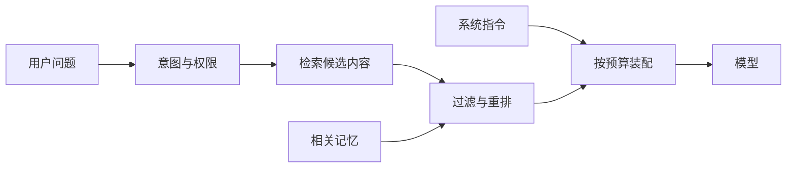

# 上下文、记忆与 RAG

上下文工程的目标是：**在正确的时间，把正确的信息，以正确的形式放进有限的上下文窗口。**

更长的上下文不代表更好的结果。无关内容会稀释关键指令，过时内容会引入冲突，未信任内容还可能带来提示注入。

## 1. 把信息分成四层

| 层级     | 典型内容                       | 生命周期        | 存储位置               |
| -------- | ------------------------------ | --------------- | ---------------------- |
| 当前输入 | 用户刚提交的目标和附件         | 当前步骤        | 运行时上下文           |
| 任务状态 | 计划、工具结果、待办、审批状态 | 一次 run/thread | Checkpoint 或业务库    |
| 长期记忆 | 用户偏好、已确认事实、过往经验 | 跨会话          | 受控的 Memory Store    |
| 外部知识 | 文档、产品手册、数据库记录     | 由数据源决定    | 搜索引擎、向量库或 API |

关键区别：**上下文是模型本次能看到的内容；记忆是一套读写和生命周期策略；RAG 是从外部知识中检索证据的方法。**

## 2. 上下文装配管线



装配时建议按稳定优先级分配预算：

1. 系统约束、安全规则和工具 Schema。
2. 用户当前目标和必要的任务状态。
3. 与问题直接相关的证据。
4. 最近对话或其摘要。
5. 可选的长期偏好与示例。

不要只按字符数硬截断。要保留语义完整的记录，并在截断后明确告知模型还有未加载的内容。

## 3. 短期记忆：不要无限堆对话

常见策略是“近期原文 + 早期摘要 + 结构化任务状态”：

```ts
type TaskMemory = {
  goal: string
  constraints: string[]
  confirmedFacts: Array<{ fact: string; source: string }>
  openQuestions: string[]
  completedSteps: string[]
  nextStep?: string
}
```

结构化状态比自然语言摘要更容易验证和更新。摘要可能丢失否定词、数字、来源和未解冲突，所以关键业务事实应存入独立字段。

## 4. 长期记忆：记什么比怎么存更重要

长期记忆可以分为：

- **Semantic memory**：用户偏好和已确认事实。
- **Episodic memory**：过往任务中有价值的事件和结果。
- **Procedural memory**：解决某类问题的经验或步骤。

每一次写入都应记录：

```ts
type MemoryRecord = {
  subjectId: string
  kind: 'preference' | 'fact' | 'episode' | 'procedure'
  content: string
  source: string
  confidence: number
  createdAt: string
  expiresAt?: string
  consent?: 'implicit' | 'explicit'
}
```

不要默认记住密码、身份证件、医疗信息或一次性敏感内容。用户应该能看到、修正和删除长期记忆。

## 5. RAG 的完整链路

RAG 不等于“把 PDF 切块后做向量搜索”。完整链路包含：

1. **入库**：解析文档，保留标题、页码、版本、权限和来源。
2. **分块**：根据标题、段落、代码函数等语义边界切分。
3. **索引**：结合关键词、向量、结构化字段和图关系。
4. **查询理解**：改写问题、拆分子问题、识别时间和权限约束。
5. **召回与重排**：先用低成本方式广泛召回，再精排和去重。
6. **上下文压缩**：仅保留能支持答案的段落，同时保留引用定位信息。
7. **生成与引用**：答案将事实与来源绑定，无证据时明确说明。
8. **评测**：分别评估检索命中率、引用正确性和最终答案。

### 为什么要混合检索

- 关键词检索擅长精确名称、错误码、版本号。
- 向量检索擅长同义表达和语义相似。
- 元数据过滤负责租户、时间、文档类型和权限。

三者结合通常比单独向量搜索更稳定。

## 6. Agentic RAG

普通 RAG 使用固定的“检索一次后回答”流程。Agentic RAG 允许模型：

- 根据首次结果改写查询；
- 选择不同数据源；
- 对冲突证据做交叉验证；
- 在证据不足时继续搜索或停止回答。

它适合多步研究任务，但需要设置查询次数、总下载量、来源域和时间预算。

## 7. 上下文质量检查

在发给模型前，对最终上下文做一次可机检的质量门禁：

- [ ] 关键指令只有一份，没有冲突版本。
- [ ] 所有外部事实都保留来源和时间。
- [ ] 只包含当前用户有权访问的内容。
- [ ] 不可信数据与系统指令有清晰边界。
- [ ] 没有把敏感密钥、完整数据库记录或无关历史塞给模型。
- [ ] 已为输出和工具结果留出足够的 token 预算。
