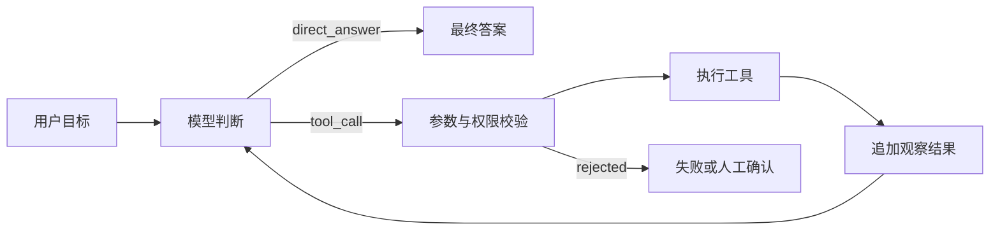

# Agent 基础与最小循环

## 1. 先理解 LLM 的边界

LLM 擅长从上下文中生成最可能的后续内容，但它不天然具备：

- 对现实世界的实时访问能力；
- 对业务数据真伪的保证；
- 稳定、可重放的逻辑执行能力；
- 对用户权限和行为后果的负责能力。

因此，真正的 Agent 应用由两个世界组成：

- **概率世界**：模型理解意图、生成计划、选择工具。
- **确定性世界**：代码负责验证参数、执行权限、记录状态和产生真实结果。

不要让模型“假装已经执行”。它只能提出工具调用请求，真正的执行必须交给受控代码。

## 2. Agent 的最小状态机



一次运行至少需要这些状态：

```ts
type Message = {
  role: 'system' | 'user' | 'assistant' | 'tool'
  content: string
  toolCallId?: string
}

type RunState = {
  runId: string
  messages: Message[]
  step: number
  status: 'running' | 'completed' | 'failed' | 'waiting_approval'
  tokenBudget: number
}
```

`runId` 用于追踪一次完整任务，`step` 和 `tokenBudget` 则是基本的停止条件。没有停止条件的 Agent 不是更自主，而是失去了运行边界。

## 3. 结构化输出是可靠性的起点

不要从自然语言中猜测模型是要回答，还是要调工具。让模型返回明确的联合类型：

```ts
type ModelDecision =
  | { type: 'final'; answer: string }
  | {
      type: 'tool_call'
      id: string
      tool: string
      arguments: Record<string, unknown>
    }
```

实际项目中应该使用模型 API 提供的 tool calling 或 JSON Schema 结构化输出，并在运行时再校验一次。类型定义只约束 TypeScript 代码，不会自动约束网络上收到的 JSON。

## 4. 一个框架无关的最小 Agent Loop

```ts
type Tool = {
  description: string
  execute: (args: Record<string, unknown>) => Promise<unknown>
}

async function runAgent(userGoal: string, tools: Record<string, Tool>, maxSteps = 8) {
  const messages: Message[] = [
    {
      role: 'system',
      content: '你是一个任务助手。只能通过已提供的工具访问外部世界。',
    },
    { role: 'user', content: userGoal },
  ]

  for (let step = 0; step < maxSteps; step += 1) {
    const decision = await callModel({ messages, tools })

    if (decision.type === 'final') {
      return { status: 'completed', answer: decision.answer, messages }
    }

    const tool = tools[decision.tool]
    if (!tool) {
      messages.push({
        role: 'tool',
        toolCallId: decision.id,
        content: JSON.stringify({ ok: false, error: 'unknown_tool' }),
      })
      continue
    }

    try {
      const data = await tool.execute(decision.arguments)
      messages.push({
        role: 'tool',
        toolCallId: decision.id,
        content: JSON.stringify({ ok: true, data }),
      })
    } catch (error) {
      messages.push({
        role: 'tool',
        toolCallId: decision.id,
        content: JSON.stringify({ ok: false, error: String(error) }),
      })
    }
  }

  return { status: 'failed', reason: 'max_steps_exceeded', messages }
}
```

这里的 `callModel` 故意没有绑定任何厂商 SDK。无论使用哪个模型，核心循环都相同：

1. 将当前状态和可用工具告诉模型。
2. 模型返回结束答案，或提出一次工具调用。
3. 应用层校验并执行工具，再把结果作为观察返回模型。
4. 直到完成、失败、超限或进入人工审批。

## 5. 提示词不是系统的全部

系统指令建议包含：

- **角色和目标**：负责解决哪类问题。
- **事实边界**：哪些结果必须来自工具，不允许猜测。
- **行为边界**：哪些操作必须先征得同意。
- **完成定义**：什么证据表明任务已经完成。
- **失败策略**：遇到信息不足、工具错误和权限不足怎么做。

但权限、金额上限、数据访问范围和审批必须由代码强制执行，不能只靠提示词。

## 6. 什么时候不应该用 Agent

下列任务通常优先使用普通代码或固定工作流：

- 输入输出规则明确，用一个函数就能稳定完成；
- 要求严格可重放，同样输入必须得到同样结果；
- 任何错误都会造成不可逆后果，又没有可靠审批机制；
- 没有可验证的完成条件，也无法评估输出质量；
- 时延或成本预算不允许多轮模型调用。

## 7. 入门练习

实现一个“城市天气助手”，它只有 `get_weather(city)` 一个工具，并满足：

- 城市为空时不执行工具；
- 工具超时时最多重试一次；
- 最多执行 4 步；
- 最终答案必须标明数据来源和查询时间；
- 每次运行保存 `runId` 和每一步的耗时。

完成这个练习，就已经掌握了 Agent 最核心的骨架。
