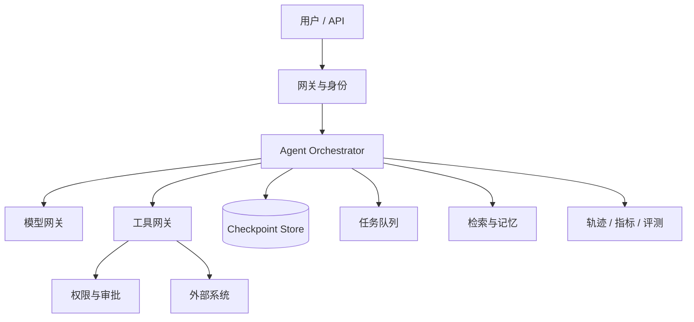

# 生产架构与可观测性

一个 Demo 只需要调通模型；一个生产 Agent 还要面对中断恢复、重复执行、并发控制、版本回滚、费用预算、隐私、审计和长时间任务。

## 1. 参考架构



### 编排层

负责状态转移、停止条件、预算、重试、中断和恢复。它不应该把所有逻辑藏在一段巨大的提示词中。

### 模型网关

统一认证、超时、限流、重试、模型路由、费用计量与内容脱敏。业务代码不应散落着多套不同厂商的重试规则。

### 工具网关

统一进行 Schema 校验、权限、幂等、审批、超时、结果裁剪和审计。工具层是 Agent 与现实世界之间最重要的安全边界。

## 2. 可恢复执行

长任务必须假设进程会崩溃、网络会中断、审批可能一天后才回来。关键设计包括：

- 每个节点完成后持久化状态和输出；
- 为所有副作用生成稳定的幂等键；
- 保存模型、提示词、工具和工作流版本；
- 恢复时从上一个已提交节点继续，不重复执行已完成副作用；
- 把取消作为正式状态，通过 `AbortSignal` 向下游传递。

```ts
type Checkpoint = {
  runId: string
  nodeId: string
  state: unknown
  workflowVersion: string
  modelVersion: string
  toolVersions: Record<string, string>
  createdAt: string
}
```

## 3. 一条可用的轨迹

一次 run 包含多个 span，例如模型调用、检索、工具执行、审批等待和子任务。每个 span 建议记录：

```ts
type TraceSpan = {
  traceId: string
  spanId: string
  parentSpanId?: string
  runId: string
  name: string
  startedAt: string
  durationMs: number
  status: 'ok' | 'error' | 'cancelled'
  model?: string
  tool?: string
  inputTokens?: number
  outputTokens?: number
  cost?: number
  retryCount?: number
  errorCode?: string
}
```

轨迹应支持回答三类问题：

1. **发生了什么**：走了哪条路径，调了哪些工具。
2. **为什么会这样**：当时的输入、版本、证据和决策结果是什么。
3. **代价是什么**：耗时、token、费用、重试和外部 API 调用量。

日志不应记录密钥、完整授权头、无需保留的个人数据或模型厂商未承诺可用的隐藏推理内容。

## 4. 成本与延迟优化

先用轨迹找到最贵和最慢的节点，再优化：

- 小模型做路由、提取和格式化，强模型只处理真正复杂的决策；
- 并行执行互不依赖的检索或子任务；
- 缓存稳定的语义检索、文档解析和确定性工具结果；
- 在调用前去掉重复和低价值上下文；
- 向用户流式返回可理解的进展，但不暴露内部隐藏推理；
- 为每种任务设置独立的步数、token、费用和总时间上限。

成本指标应使用“单个成功任务成本”，因为一个很便宜但经常失败的 Agent 并不经济。

## 5. 并发、背压与限流

多轮 Agent 会将一个用户请求放大成多次模型和工具调用。必须在三层限制：

- **用户/租户层**：每分钟请求数、同时运行任务数、日预算。
- **Run 层**：最大步数、扇出、子 Agent 数和费用。
- **依赖层**：每个模型、搜索和外部 API 的并发池。

当下游拥塞时，应该减少新任务、延后非关键任务或降级功能，而不是无限开启并发重试。

## 6. 版本与发布

以下东西都要可版本化和回滚：

- 系统指令与示例；
- 模型名称和采样参数；
- 工具 Schema、描述和实现；
- 检索索引、分块策略和 reranker；
- 工作流图和分支规则；
- 评测集和评分 rubric。

发布时采用影子流量、小流量灰度或 A/B 对比。先看安全与任务成功率，再看成本与用户体验；不要只因为新版本输出“更像人”就全量上线。

## 7. 生产就绪检查表

- [ ] 定义了可机检的完成和失败条件。
- [ ] 任务可以暂停、取消、恢复和超时。
- [ ] 所有写工具支持幂等，高风险行为有审批。
- [ ] 有按任务类型分组的成功率、延迟、成本和安全指标。
- [ ] 轨迹能连接主任务、子任务、模型和工具调用。
- [ ] 日志经过脱敏，且有保留期和访问控制。
- [ ] 回归评测与发布流程绑定，高风险样本失败会阻止发布。
- [ ] 模型、提示词、工具和工作流都能独立回滚。
- [ ] 定义了人工接管、故障降级与紧急停止机制。
