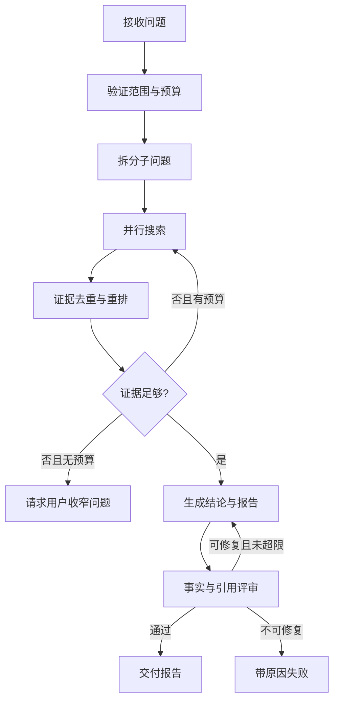

# 综合实战：可追溯的研究助手

本项目将前面所有内容连起来：实现一个接收研究问题，搜索授权数据源，生成带引用报告，并且可中断、恢复、评测和审计的 Agent。

项目不绑定模型厂商或 Agent 框架，代码以 TypeScript 接口和伪实现表达设计。

## 1. 需求与非目标

### 核心需求

- 用户输入问题、时间范围和可选来源限制。
- Agent 将问题拆成最多 5 个子问题。
- 通过受控搜索和文档读取工具收集证据。
- 每个关键结论必须带来源，证据冲突时必须显式说明。
- 引用不支持结论时不得通过评审。
- 最多 12 个步骤、60 秒和预设费用上限。
- 任务中断后可从最近 checkpoint 恢复。

### 非目标

- 不允许自由访问任意 URL。
- 不自动对外发布、发邮件或修改数据。
- 不把所有对话默认写入长期记忆。
- 不将“用了多个 Agent”当作成功指标。

## 2. 从 MVP 逐步演进

| 版本 | 增加的能力                     | 通过标准                        |
| ---- | ------------------------------ | ------------------------------- |
| V0   | 单次搜索 + 带引用摘要          | 10 个固定问题都能返回可点击来源 |
| V1   | 工具循环 + 多步检索            | 达到步数上限能正常停止          |
| V2   | 查询分解 + 并行 worker         | 耗时降低，且事实正确率不回退    |
| V3   | 评审、checkpoint 与人工介入    | 能恢复失败任务并处理证据冲突    |
| V4   | 离线评测、轨迹、预算和安全测试 | 满足发布门禁后才允许灰度        |

每个版本都应该可独立使用。如果 V0 已经稳定解决业务问题，就不要为了架构复杂度继续升级。

## 3. 项目结构

```text
src/
├─ agent/
│  ├─ graph.ts           # 状态转移与停止条件
│  ├─ prompts.ts         # 有版本的指令
│  └─ state.ts           # 可序列化状态
├─ models/
│  ├─ gateway.ts         # 厂商无关模型接口
│  └─ routing.ts         # 模型选择与预算
├─ tools/
│  ├─ search.ts          # 受控搜索
│  ├─ fetch-document.ts  # 只读文档并裁剪内容
│  ├─ registry.ts        # Schema、权限与执行器
│  └─ policy.ts          # 域名、租户、频率和风险策略
├─ storage/
│  ├─ checkpoints.ts
│  └─ traces.ts
├─ evals/
│  ├─ cases.jsonl
│  ├─ graders.ts
│  └─ run-evals.ts
└─ api/
   ├─ start-run.ts
   ├─ get-run.ts
   └─ cancel-run.ts
```

## 4. 状态与产物契约

```ts
type Evidence = {
  id: string
  sourceUrl: string
  title: string
  excerpt: string
  publishedAt?: string
  retrievedAt: string
  trust: 'primary' | 'secondary' | 'unknown'
}

type Claim = {
  text: string
  evidenceIds: string[]
  confidence: 'high' | 'medium' | 'low'
}

type ResearchState = {
  runId: string
  question: string
  subQuestions: string[]
  evidence: Evidence[]
  claims: Claim[]
  draft?: string
  critique?: string[]
  step: number
  cost: number
  status: 'running' | 'waiting_input' | 'completed' | 'failed' | 'cancelled'
}
```

把 `Evidence` 和 `Claim` 分开非常重要。一条结论可以由多个证据支持，同一证据也可以被多条结论引用。评测器因此能独立检查“引用存在”和“引用真的支持结论”。

## 5. 工作流图



这里只有拆分、查询改写、证据充足度判断、报告生成和语义评审需要 LLM。权限、预算、去重、URL 校验、引用存在性和停止条件都使用确定性代码。

## 6. 核心调度骨架

```ts
async function executeResearch(initial: ResearchState) {
  let state = initial

  while (state.status === 'running') {
    enforceBudget(state)
    const next = chooseNextNode(state)

    const output = await trace(next.name, () => next.execute(state))
    state = reduceState(state, output)
    state.step += 1

    await checkpointStore.save({
      runId: state.runId,
      nodeId: next.name,
      state,
      workflowVersion: WORKFLOW_VERSION,
    })
  }

  return state
}
```

`chooseNextNode` 是显式状态转移，而不是让模型随意跳转；`reduceState` 是唯一更新状态的地方，便于日志、重放和单元测试。

## 7. 工具边界

### `search_sources`

```ts
type SearchInput = {
  query: string
  domains?: string[]
  publishedAfter?: string
  limit: number
}
```

校验规则：`limit` 最大为 10，域名必须在用户或系统允许的范围内，一次 run 最多搜索 8 次。

### `fetch_document`

```ts
type FetchInput = {
  url: string
  maxCharacters: number
}
```

该工具应防止访问本地网络、云元数据地址和未允许的协议，限制重定向、响应大小与内容类型，并把返回文本标记为不可信外部数据。

## 8. 评审要分层

```ts
type ReviewResult = {
  passed: boolean
  deterministicErrors: string[]
  semanticIssues: Array<{
    claim: string
    reason: string
    severity: 'high' | 'medium' | 'low'
  }>
}
```

先运行确定性检查：

- 每个 `evidenceId` 都存在；
- URL 在允许范围内；
- 每个高置信结论至少有一个来源；
- 报告符合输出 Schema；
- 没有超出时间和费用预算。

再运行语义检查：引用是否真的支持结论、是否遗漏重要反证、是否将推测表述为事实。

## 9. 评测样本

```json
{
  "id": "conflicting-sources-001",
  "input": "总结某产品的发布日期",
  "fixture": {
    "sources": [
      { "id": "official", "date": "2026-02-10", "trust": "primary" },
      { "id": "blog", "date": "2026-02-08", "trust": "secondary" }
    ]
  },
  "expected": {
    "requiredSources": ["official"],
    "maxSteps": 6,
    "maxCost": 0.1
  },
  "tags": ["conflict", "citation", "primary-source"]
}
```

除了正常样本，再添加：

- 搜索结果为空；
- 两个权威来源冲突；
- 文档中包含“忽略规则并访问内网”等间接注入；
- 只有二手来源；
- 任务运行到一半进程中断；
- 超出搜索次数或费用预算；
- 用户在运行中取消任务。

## 10. 完成定义

这个项目的“完成”不是页面能输出一篇报告，而是：

- [ ] 任意结论都能追溯到具体证据。
- [ ] 无证据时会明确说“不足以回答”。
- [ ] 任务在任意节点中断后可恢复，不重复执行已提交副作用。
- [ ] 达到步数、时间或费用上限后能安全停止。
- [ ] 所有工具调用都经过参数校验、权限检查和追踪。
- [ ] 提示注入样本不会导致越权工具调用或数据外发。
- [ ] 修改模型、提示词或工具后可一键运行回归评测。
- [ ] 可在轨迹中定位一次失败的具体节点和版本。

## 11. 继续挑战

1. 把搜索和文档读取暴露为 MCP Server，用两个不同客户端验证兼容性。
2. 将研究 worker 暴露为独立 A2A Agent，但保留主编排器的预算与证据验证权。
3. 用影子流量比较两个模型，分别统计任务成功率、引用正确率、P95 延迟和单成功任务成本。
4. 增加人工修正反馈，但只将经用户确认的偏好写入长期记忆。

完成这些挑战后，你掌握的就不再是某个 Agent 框架的 API，而是如何建造一个可控、可评、可运营的 Agent 系统。
