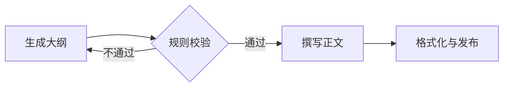

# Agentic Workflow

很多所谓的“Agent”，其实更适合做成工作流：让代码掌揧大的路径，只在需要语义判断的节点调用模型。这样更好测试、更容易解释，也更便宜。

## 1. 选择自主程度

```text
普通函数 → 单次 LLM → 固定工作流 → 带分支的状态图 → 自主 Agent
   更可预测、便宜、快                      更灵活、贵、难以预测
```

选择足以解决问题的最低复杂度。只有当任务路径无法预先枚举，且环境能够持续提供可验证反馈时，自主 Agent 才开始显示优势。

## 2. 五种高频模式

### Prompt Chaining：提示链

把复杂任务拆成顺序的小任务，每步都有明确输入输出。



适用于能够清晰分解，且中间结果可检查的任务。

### Routing：路由

先判断输入类别，再交给专用处理器。例如客服问题路由到订单、退款、技术支持或人工队列。

分类结果必须是受限枚举，并且有 `unknown` 降级路径，不能让模型自由生成一个新服务名。

### Parallelization：并行

适合互不依赖的子任务：

- **Sectioning**：将报告拆成市场、产品和风险三部分并行研究。
- **Voting**：用多个独立判断检查高风险内容，再按规则汇总。

并行会减少墙钟时间，但会提高瞬时并发和成本。合并阶段要处理重复、冲突和部分失败。

### Orchestrator–Workers：编排者与工作者

编排者根据具体问题动态拆分子任务，工作者完成后再汇总。它与固定并行的区别是：子任务的数量和内容事先并不确定。

编排者不应该只输出一段散文计划，而应输出可调度的任务图：

```ts
type WorkItem = {
  id: string
  objective: string
  dependsOn: string[]
  allowedTools: string[]
  expectedOutput: string
  acceptanceCriteria: string[]
  maxSteps: number
}
```

### Evaluator–Optimizer：生成与评审

一个节点生成结果，另一个节点根据明确标准评审并给出可操作的修改意见。

要求同时满足：

- 评价标准可表达，例如格式、事实引用、测试结果。
- 修改可以显著提高评分。
- 有最大迭代数和停止阈值，避免无限“再改进一点”。

## 3. 将流程建模为状态图

```ts
type WorkflowState = {
  runId: string
  goal: string
  route?: 'simple' | 'research' | 'human'
  evidence: Array<{ source: string; excerpt: string }>
  draft?: string
  review?: { passed: boolean; feedback: string[] }
  attempts: number
  status: 'running' | 'waiting_approval' | 'completed' | 'failed'
}
```

一个好的状态图需要：

- 节点尽量小且职责单一；
- 状态是可序列化的，不存放未完成连接等进程内对象；
- 每个节点都可单独重试，写操作具有幂等性；
- 分支条件有显式枚举，并且存在兜底路径；
- 关键节点后保存 checkpoint，可从中断处恢复；
- 决策与副作用分离，方便在写入前插入审批。

## 4. Human-in-the-loop

人工节点不应只有“继续/取消”两个按钮。一个有效的审批界面应展示：

- Agent 打算做什么；
- 具体对象、参数和预期副作用；
- 使用了哪些证据作出决策；
- 是否可撤销，取消后会发生什么；
- “批准”、“修改参数后批准”、“驳回并给出反馈”三种操作。

暂停时必须将状态持久化，审批回来后从同一个 checkpoint 恢复，而不是从头重跑。

## 5. 错误处理是流程的一部分

| 错误          | 建议策略                               |
| ------------- | -------------------------------------- |
| 瞬时网络错误  | 有上限的退避重试                       |
| 参数不合法    | 返回结构化错误，允许模型修正一次       |
| 权限不足      | 直接停止或请求人工，不重试             |
| 评审不通过    | 带反馈返回生成节点，限制迭代次数       |
| 超出步数/费用 | 保存已完成内容，返回部分结果和继续方式 |
| 不可恢复错误  | 进入失败状态，附带可诊断信息           |

## 6. 框架选型原则

在需要持久化状态图、流式输出、人工中断和恢复时，可以考虑 LangGraph 等编排层。但选框架前先确认：

- 能否看到原始模型请求、响应和工具调用；
- 状态和 checkpoint 能否导出与迁移；
- 每个节点能否独立测试和重放；
- 是否允许混合确定性节点和 LLM 节点；
- 是否支持你真正需要的运行时，而不是只追求“几行代码开始”。

参考：[Building Effective AI Agents](https://www.anthropic.com/research/building-effective-agents) 与 [LangGraph Overview](https://docs.langchain.com/oss/python/langgraph/overview)。
