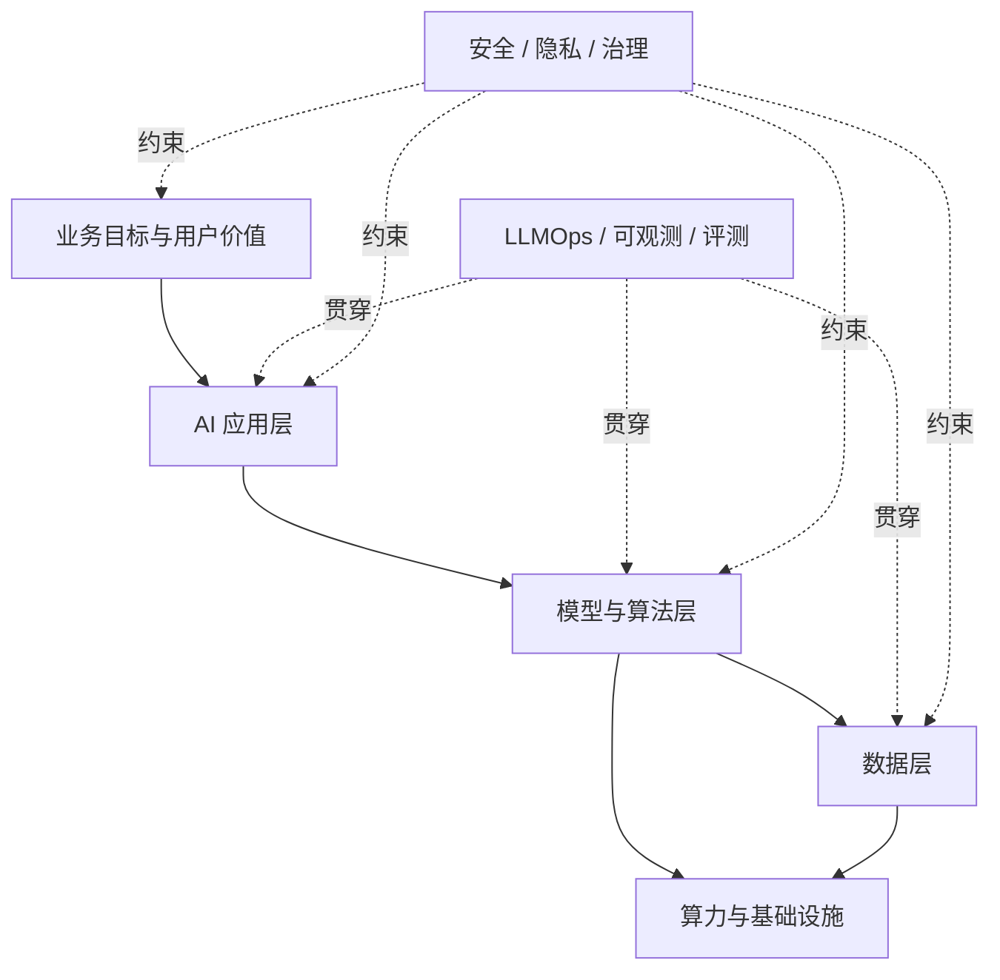
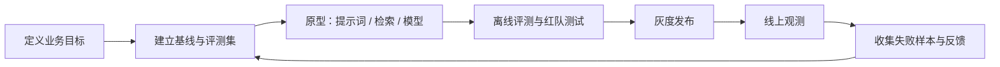

# AI 研发与生态：从基础到生产

AI 研发不只是“调用一个模型”，而是一条由数据、模型、计算、应用工程、评测和治理共同组成的链路。真正可持续的 AI 产品，需要这些部分能够一起迭代、观测和回滚。

可以先记住一个简化公式：

> AI 产品 = 数据 × 模型 × 计算 × 工程 × 评测 × 治理

这里使用乘号，是因为任何一项接近零，整体效果都会迅速下降。

## 一张图看懂 AI 研发全景

## 三条常见研发路线

| 路线 | 适合谁 | 优点 | 主要挑战 |
| --- | --- | --- | --- |
| 调用模型 API | 应用团队、快速验证团队 | 上线快、运维轻、模型能力更新快 | 数据边界、成本、供应商依赖 |
| 使用开放权重模型并微调或自托管 | 有领域数据、隐私或延迟要求的团队 | 可定制、可控、部署方式灵活 | GPU、推理优化、模型运维 |
| 从头训练基础模型 | 大型研究机构或基础模型公司 | 数据、架构和能力完全自主 | 数据、算力、人才和实验成本极高 |

多数团队应从第一条路线开始，用评测确认瓶颈后，再决定是否引入检索、微调或自托管。不要把“训练模型”当作默认起点。

## 学习地图

| 阶段         | 核心问题                                     | 对应章节                                        |
| ------------ | -------------------------------------------- | ----------------------------------------------- |
| 建立概念     | AI、机器学习、大模型和生成式 AI 有什么关系？ | [基础概念与模型原理](./foundations.md)          |
| 理解模型研发 | 预训练、指令微调、偏好优化分别解决什么问题？ | [模型研发与后训练](./model-development.md)      |
| 建设数据资产 | 数据如何采集、清洗、标注、切分和版本化？     | [数据工程](./data-engineering.md)               |
| 构建产品     | 如何组合模型、检索、工具和业务系统？         | [AI 应用工程](./application-engineering.md)     |
| 上线服务     | 如何控制延迟、吞吐、显存与单位成本？         | [推理与基础设施](./inference-infrastructure.md) |
| 持续迭代     | 如何追踪实验、提示词、模型、评测和线上反馈？ | [LLMOps](./llmops.md)                           |
| 控制风险     | 如何处理提示词注入、隐私、供应链和合规？     | [安全与治理](./security-governance.md)          |
| 选择工具     | 训练、服务、观测等生态工具如何分层选型？     | [生态工具版图](./ecosystem-map.md)              |
| 系统练习     | 如何按 12 周路径完成一个可展示的项目？       | [学习路线与实战](./roadmap.md)                  |

完成应用工程基础后，可以继续学习专项内容：[AI Agent：从入门到生产](../ai-agent/README.md)。

## 典型岗位与关注点

| 角色                  | 主要关注点                       | 常见交付物                       |
| --------------------- | -------------------------------- | -------------------------------- |
| 算法 / 模型工程师     | 数据、训练、后训练、评测         | 模型权重、训练方案、评测报告     |
| 数据工程师            | 数据质量、血缘、管道、权限       | 数据集、特征或语料管道、质量报告 |
| AI 应用工程师         | 提示词、RAG、工具调用、业务集成  | API、工作流、AI 功能             |
| 推理 / 平台工程师     | GPU、调度、吞吐、稳定性、成本    | 推理服务、平台能力、容量方案     |
| MLOps / LLMOps 工程师 | 版本、实验、发布、观测、反馈闭环 | 流水线、注册表、监控与回滚机制   |
| AI 安全与治理         | 风险评估、红队、隐私、合规       | 风险清单、控制措施、审计证据     |
| 产品经理 / 领域专家   | 用户价值、验收标准、领域知识     | 场景定义、标注规范、评测集       |

## 一套通用研发闭环

每轮迭代都应能回答四个问题：质量是否提高、风险是否可接受、延迟是否达标、单位任务成本是否下降。

## 权威资料入口

- [PyTorch 文档](https://docs.pytorch.org/docs/stable/index.html)：深度学习框架与分布式训练。
- [Hugging Face Datasets](https://huggingface.co/docs/datasets/index)：数据加载、处理、流式读取及多模态数据集。
- [Hugging Face PEFT](https://huggingface.co/docs/peft/index)：参数高效微调。
- [Hugging Face TRL](https://huggingface.co/docs/trl/index)：监督微调与偏好优化等后训练方法。
- [vLLM 文档](https://docs.vllm.ai/en/latest/)：大模型推理与服务。
- [MLflow GenAI](https://mlflow.org/docs/latest/genai/)：追踪、评测、提示词管理与应用生命周期。
- [NIST AI Risk Management Framework](https://www.nist.gov/itl/ai-risk-management-framework)：AI 风险治理框架。

> 工具会快速变化，但“目标—数据—模型—评测—部署—反馈—治理”的主线相对稳定。先掌握主线，再选择工具。
