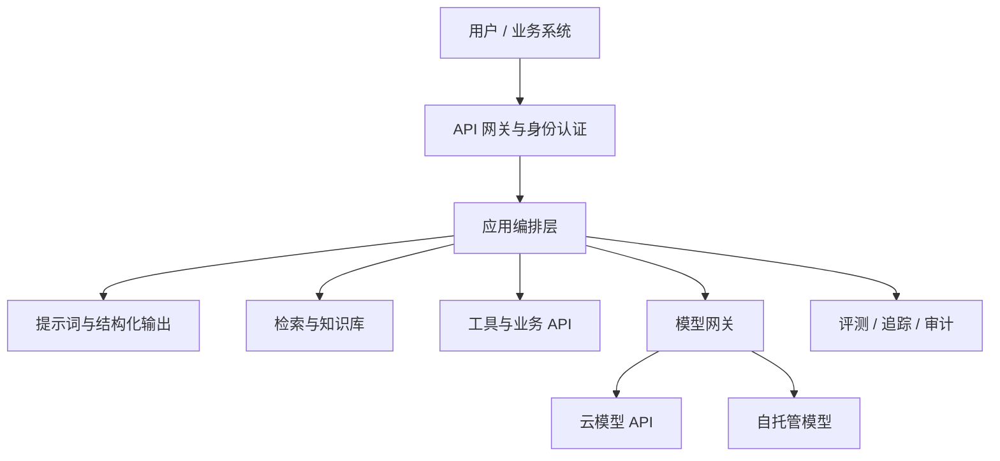

# AI 应用工程

AI 应用工程的核心，是把概率性的模型能力放进确定性的软件边界：输入可校验、过程可观测、输出可验证、失败可降级、高风险操作可审批。



## 从简单方案开始

| 复杂度 | 方案                  | 什么时候使用                       |
| ------ | --------------------- | ---------------------------------- |
| 1      | 单次模型调用          | 摘要、分类、改写、抽取             |
| 2      | 结构化输出 + 代码校验 | 需要接入后续系统                   |
| 3      | RAG                   | 需要私有、最新、可引用知识         |
| 4      | 工具调用              | 需要查实时状态或执行动作           |
| 5      | Workflow              | 步骤确定、分支和审批可预先描述     |
| 6      | Agent                 | 步骤未知，需要根据环境反馈动态决策 |

复杂度越高，失败模式、延迟和测试成本越高。只有当低一层方案无法满足任务时，才继续升级。

## 提示词是接口，不是咒语

稳定提示词通常包括：

1. **角色与目标**：模型要完成什么，不要只写身份设定。
2. **输入边界**：明确哪些内容是数据，哪些内容是可信指令。
3. **约束与拒答**：何时停止、何时承认不知道、何时请求人工处理。
4. **输出契约**：JSON Schema、字段解释、单位和枚举范围。
5. **少量示例**：覆盖正常情况与关键边界情况。

提示词应进入版本管理，并与模型版本、评测结果绑定。改一个词也可能改变行为，所以不能只保存在控制台或个人文档里。

## 结构化输出与校验

模型生成的 JSON 只是候选数据，进入业务系统前仍需：

- 语法与 Schema 校验。
- 类型、长度、范围、枚举和跨字段业务规则校验。
- 资源 ID、用户权限和幂等键检查。
- 对无效输出进行有限次数重试，超过阈值后降级或转人工。

不要让模型直接拼接 SQL、命令或 HTML 并无条件执行。将模型限制为选择经过审计的工具和参数，由确定性代码执行。

## RAG：把知识放在模型之外

RAG 常见流程是：文档解析 → 分块 → 建索引 → 查询改写 → 检索 → 重排 → 生成 → 引用校验。

它适合经常更新、需要权限控制或必须给出处的知识。重点不是向量数据库品牌，而是：

- 分块是否保留语义和文档结构。
- 检索是否同时利用关键词与语义信号。
- 权限过滤是否在检索阶段生效。
- 回答是否由证据支持，引用是否能定位原文。
- 文档更新、删除后索引能否及时同步。

详细设计见 [Agent 上下文、记忆与 RAG](../ai-agent/context-memory-rag.md)。

## 工具调用

工具让模型获取实时信息或执行动作。每个工具都应有狭窄、明确、可验证的契约：

```text
名称：create_refund_request
输入：order_id、reason、requested_amount
权限：只能为当前登录用户创建申请
副作用：创建申请，不直接退款
返回：request_id、status、next_step
```

把“查询”和“变更”工具分开；变更操作使用幂等键、最小权限、确认页面和审计日志。高风险动作应由人或确定性策略批准。

## 多模态应用

多模态不是简单地把图片附在提示词后。还需要处理：

- 文件类型、大小、分辨率、时长和恶意内容检测。
- OCR、版面、时间轴、说话人或区域坐标等结构信息。
- 图片与文档中的间接提示词注入。
- 原始媒体、派生文本和向量的权限与保留期。
- 质量评测中的模态切片，例如低光图片、口音、扫描件。

## 模型网关与可替换性

应用层尽量使用自己的稳定接口，避免业务代码散落供应商字段。网关可以统一：

- 模型路由、超时、重试、限流与熔断。
- 身份凭证、数据策略和区域选择。
- 输入输出日志的脱敏和采样。
- 成本预算、缓存、降级与回退模型。
- 模型版本切换和 A/B 测试。

“可替换”不表示不同模型行为完全等价。切换前仍需运行回归评测。

## 缓存与降级

- **精确缓存**：相同输入和配置直接复用结果，适合确定性任务。
- **语义缓存**：相似问题复用答案，必须控制新鲜度、权限和误匹配。
- **上下文缓存**：复用稳定前缀，降低长上下文成本。
- **降级策略**：缩短上下文、关闭非核心步骤、切换模型或返回可解释的稍后处理状态。

缓存键应包含模型、提示词、知识库和安全策略版本，否则可能返回过期或越权内容。

## 生产级接口清单

- 明确输入、输出、错误码、超时与幂等语义。
- 每个请求都有追踪 ID，并记录模型与提示词版本。
- 设置 Token、费用、工具次数和总执行时间上限。
- 对模型输出进行 Schema、事实证据和安全校验。
- 区分用户错误、模型错误、依赖错误和策略拒绝。
- 提供人工接管、回放、灰度和回滚能力。

如果任务需要自主规划、循环调用工具或多 Agent 协作，再继续学习 [AI Agent 专栏](../ai-agent/README.md)。
