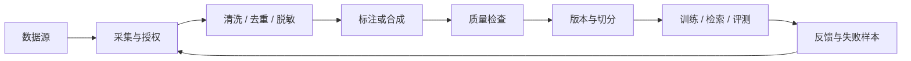

# AI 数据工程

数据工程决定模型看见什么、学会什么，以及团队能否解释结果。它不只是“准备一个文件夹”，而是将来源、许可、质量、版本、血缘和访问控制连接起来。



## 先定义数据契约

数据契约描述一份数据能否被正确理解和长期使用，至少应包含：

- 字段名称、类型、是否必填和示例。
- 来源、采集时间、语言、领域和更新频率。
- 许可证、授权范围、保留期限和删除机制。
- 敏感级别、允许访问的角色和使用目的。
- 质量规则、去重方式、异常处理和负责人。
- 数据集版本以及上游、下游血缘。

如果这些信息只存在某位工程师的记忆里，数据就还不是可运营资产。

## 不同用途的数据不同

| 数据用途   | 典型结构                     | 重点                           |
| ---------- | ---------------------------- | ------------------------------ |
| 预训练语料 | 大规模原始文本或多模态内容   | 授权、覆盖、去重、污染和配比   |
| SFT 数据   | 指令、上下文、理想回答       | 答案质量、任务覆盖、格式一致   |
| 偏好数据   | 输入、候选答案、偏好或排序   | 标注一致性、偏好偏差、难例覆盖 |
| RAG 语料   | 文档、章节、元数据、权限     | 新鲜度、分块、可引用、访问控制 |
| 评测集     | 输入、参考答案、评分标准     | 代表性、稳定性、与训练集隔离   |
| 线上反馈   | 请求、结果、反馈、运行上下文 | 隐私、采样偏差、噪声和可追溯性 |

同一份内容可以衍生多种数据产品，但应有独立版本和用途限制。

## 采集、授权与隐私

在采集前回答：谁拥有数据、用户是否同意、是否允许训练、是否允许跨区域处理、能否按请求删除。公开可访问不等于可随意训练。

敏感信息处理通常包括：

- 识别个人身份信息、商业秘密和受监管数据。
- 在进入训练或标注系统前进行删除、遮蔽、假名化或聚合。
- 采用最小权限、短期凭证和完整审计日志。
- 明确保留期，并能从派生数据集和索引中执行删除。

仅在展示层遮住敏感字段不够；原始文件、缓存、向量库、日志和备份都可能形成副本。

## 清洗、过滤与去重

常见质量处理包括：

1. 编码、格式和语言检测。
2. 空内容、模板页、乱码和异常长度过滤。
3. 精确去重与近似去重。
4. 低质量、垃圾、恶意指令和不合规内容过滤。
5. 文档结构解析，保留标题、章节、表格与来源元数据。
6. 分布统计和抽样人工审查。

过滤越强不一定越好。过度过滤会损失小语种、少数群体表达和长尾知识，因此每条规则都要记录命中量，并抽查误删样本。

## 标注体系

一份可执行的标注规范需要说明：

- 标签定义、正例、反例和边界情况。
- 无法判断时的处理方式。
- 多标签冲突的优先级。
- 质量抽检比例和仲裁流程。
- 标注员资格、培训和敏感内容保护。

使用一致率、复标率和争议率监控标注质量。低一致率不一定是标注员问题，也可能说明任务定义本身含糊。

## 合成数据

模型生成的数据可用于扩充难例、生成反例、覆盖格式组合或蒸馏能力，但必须有质量闸门：

- 保存生成模型、提示词、采样参数和时间。
- 通过规则、模型评审和人工抽检多重筛选。
- 与真实数据分别统计效果。
- 防止训练模型反复学习自身错误和固定措辞。
- 不使用合成数据绕开原数据的许可或隐私约束。

## 数据切分与泄漏

随机切分经常低估真实难度。根据任务选择更严格的方式：

- **按时间切分**：验证对未来数据的泛化。
- **按用户 / 客户切分**：避免同一主体跨训练与测试。
- **按文档或语义簇切分**：避免近似重复内容泄漏。
- **按来源切分**：验证跨域能力。

评测集应冻结并限制访问。若团队持续根据测试集调参，测试集就已成为训练过程的一部分，需要建立新的盲测集。

## 版本、血缘与可删除性

每个数据集版本应能回答：

```text
它来自哪里？经过哪些规则？谁批准的？
训练了哪些模型？进入了哪些索引？
某条记录被撤回时，需要重建哪些产物？
```

可以把数据版本视为不可变快照，把修正发布为新版本。训练运行、模型版本和线上服务都引用明确的数据版本，而不是“latest”目录。

Hugging Face Datasets 基于 Arrow，并支持文本、音频、计算机视觉等数据以及流式加载；可参考其[官方文档](https://huggingface.co/docs/datasets/index)理解通用数据处理能力。大规模生产管道还需要结合对象存储、数据仓库、调度和权限系统。

## 数据质量看板

建议按版本跟踪：

- 数据量、语言、来源、主题和敏感等级分布。
- 重复率、空值率、异常率、过滤率和标注争议率。
- 训练集与评测集相似度、已知污染比例。
- 数据新鲜度、处理延迟、失败任务和删除完成率。
- 各切片上的模型质量，而不只是全局平均分。

## 建立反馈飞轮

线上差评不能直接当作训练标签。一个安全的反馈闭环是：采样失败任务 → 去除敏感信息 → 归因和复核 → 补充评测集 → 比较候选改动 → 审批后进入训练数据。

数据飞轮的核心不是“自动把所有对话拿去训练”，而是持续把真实失败转化为经过治理的高价值样本。
