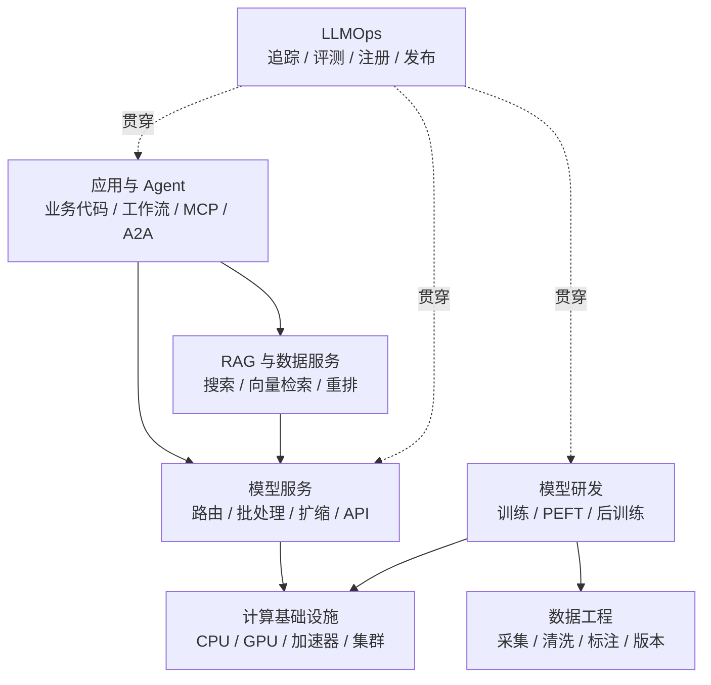

# AI 研发生态工具版图

AI 工具更新很快。与其背诵产品名称，不如先按职责分层：每层解决什么问题、输入输出是什么、是否能替换、由谁维护。



## 分层速查

下表列出的是代表性项目，不是固定推荐清单。

| 层级 | 解决的问题 | 代表性工具 / 生态 | 选型关注点 |
| --- | --- | --- | --- |
| 计算与调度 | 提供加速器、网络、存储和作业调度 | GPU / TPU、Kubernetes、Slurm、云计算平台 | 可用性、网络、成本、配额、运维能力 |
| 深度学习框架 | 定义模型、自动求导和训练 | PyTorch、JAX / Flax、TensorFlow | 模型生态、分布式能力、团队经验 |
| 模型与数据中心 | 发布、下载、版本化模型和数据 | Hugging Face Hub、企业内部模型仓库 | 许可、可信来源、访问控制、镜像和审计 |
| 数据处理 | 加载、清洗、转换和分布式处理 | Datasets / Arrow、Spark、Ray Data、数据仓库 | 数据规模、格式、血缘、流式处理 |
| 训练与分布式 | 训练大模型并管理并行和检查点 | Transformers、Accelerate、PyTorch FSDP、DeepSpeed | 并行策略、容错、硬件效率、检查点兼容 |
| 微调与后训练 | LoRA、SFT、偏好优化 | PEFT、TRL、各训练框架扩展 | 算法覆盖、数据格式、评测与可复现性 |
| 推理引擎 | 优化大模型生成效率 | vLLM、TGI、SGLang、TensorRT-LLM | 模型 / 硬件支持、延迟、吞吐、量化 |
| 模型服务 | 网关、调度、扩缩、多模型管理 | Triton、Ray Serve、KServe、云模型服务 | SLO、协议、冷启动、弹性、隔离 |
| 搜索与向量检索 | 为 RAG 提供关键词、向量和混合检索 | Elasticsearch / OpenSearch、pgvector、Milvus 等 | 召回质量、过滤、规模、一致性和成本 |
| 应用编排 | 组合模型、检索、工具和状态 | 业务代码、状态机、LangGraph 等 | 可控性、调试、持久化、框架锁定 |
| 实验与注册 | 跟踪运行、版本和模型产物 | MLflow、Weights & Biases 等 | 元数据、私有部署、集成、权限 |
| 可观测与评测 | Trace、指标、日志、数据集和评分 | OpenTelemetry、评测平台、内部看板 | 开放标准、隐私、成本、可扩展性 |
| 互操作协议 | 连接工具、数据和其他 Agent | MCP、A2A、HTTP / OpenAPI、事件总线 | 信任边界、身份、版本、生态成熟度 |
| 安全治理 | 策略、扫描、红队、审计与合规 | OWASP 指南、NIST AI RMF、内部治理平台 | 风险场景、证据链、可执行控制 |

## 不要按热度选型

先写清五类需求：

1. **任务**：生成、分类、检索、视觉还是实时语音？
2. **约束**：质量、P95 延迟、并发、成本和数据边界是多少？
3. **规模**：单模型还是多模型，单机还是多集群，流量是否稳定？
4. **能力**：团队愿意长期运维哪些组件？
5. **退出机制**：如何导出数据、替换模型、迁移接口和回滚？

然后做小规模基准测试和故障演练。功能清单相似，不代表在你的模型、硬件和流量下表现相同。

## 三种参考架构

### API 优先：快速验证产品

```text
Web / App → 自有后端 → 模型网关 → 云模型 API
                       ↘ 检索 / 业务工具
                       ↘ 追踪 / 评测
```

适合小团队和需求探索。重点是建立自有接口、评测和成本护栏，避免业务代码直接绑定单一供应商。

### 开放权重：隐私或成本可控

```text
应用网关 → 推理服务 → 推理引擎 → GPU 集群
       ↘ RAG                 ↘ 模型仓库
       ↘ 观测 / 评测 / 灰度发布
```

适合有数据边界、定制或稳定高流量需求的团队。需要承担容量、GPU、驱动、权重和服务可靠性。

### 模型研发：训练与后训练平台

```text
数据湖 / 仓库 → 数据处理 → 分布式训练 → 模型注册
                                   ↓
评测集 / 红队集 ← 候选模型 ← 后训练与合并
                                   ↓
                              灰度推理服务
```

适合持续生产模型版本的团队。核心资产是可复现的数据与训练链路，不只是某个训练脚本。

## Build、Buy 还是开源自建

| 选择         | 适合情况                           | 主要代价                     |
| ------------ | ---------------------------------- | ---------------------------- |
| 购买托管服务 | 需要快速上线，团队不想运维基础设施 | 持续费用、数据边界、迁移成本 |
| 开源自建     | 有定制、隐私、规模或成本需求       | 运维、安全、升级和人才投入   |
| 自研核心能力 | 能形成业务差异，且现有工具无法满足 | 研发周期长、长期维护责任大   |

通常把差异化业务逻辑留在内部，把通用基础能力交给成熟工具。所谓“自建”也应尽量基于开放格式和标准接口。

## 协议：MCP 与 A2A

- [MCP](https://modelcontextprotocol.io/docs/getting-started/intro)用于标准化 AI 应用如何连接工具、资源和提示模板。
- [A2A](https://a2a-protocol.org/latest/)关注独立 Agent 之间的发现、任务协作和结果交换。

协议提升互操作性，但不会替你解决身份认证、授权、数据分类和业务审批。每个连接仍要纳入威胁模型。

## 成熟度阶梯

| 阶段        | 目标                   | 最小能力                           |
| ----------- | ---------------------- | ---------------------------------- |
| 1. 原型     | 验证用户价值           | 单一模型、少量评测、人工观察       |
| 2. 可发布   | 安全地给真实用户使用   | 鉴权、日志、评测门槛、限额、回退   |
| 3. 可运营   | 持续稳定迭代           | 版本链、灰度、监控、成本与事故响应 |
| 4. 平台化   | 支持多个团队和场景     | 多租户、自助发布、标准组件和治理   |
| 5. 规模优化 | 提升资源效率和组织复用 | 容量调度、模型组合、统一评测与策略 |

不要在还没有验证用户价值时就建设五级平台。每一级都应由明确的业务瓶颈驱动。

## 常见反模式

- 因为框架支持 Agent，就把所有任务都做成 Agent。
- 同时引入多个重叠平台，却没有明确系统边界和负责人。
- 只看榜单和演示，不用真实数据测试质量、延迟与成本。
- 让应用直接依赖某家模型的所有私有字段，没有适配层和回归集。
- 只记录最终答案，不记录检索、工具、版本和中间失败。
- 把“用了开源模型”误认为没有许可证、供应链和隐私风险。

一个健康的生态架构应当可以解释、可以替换、可以观测，也可以在故障时收缩到更简单的模式。
