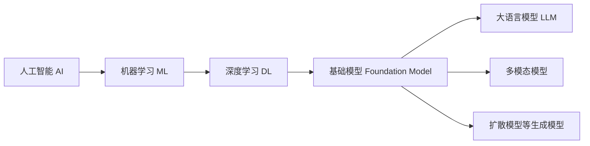

# 基础概念与模型原理

## 概念之间的关系

- **人工智能**：让机器完成通常需要人类智能的任务。
- **机器学习**：从数据中学习规律，而不是把每条规则都写进程序。
- **深度学习**：使用多层神经网络学习复杂表示。
- **基础模型**：在大规模数据上训练，可适配多个下游任务的模型。
- **生成式 AI**：生成文本、图像、音频、视频或结构化数据的系统。
- **大语言模型**：以语言建模为核心，通常也能处理代码、图像或音频。

这些概念不是互相替代的产品名称，而是不同层级和侧重点。

## 机器学习的基本范式

| 范式                | 数据形式               | 典型任务                   |
| ------------------- | ---------------------- | -------------------------- |
| 监督学习            | 输入与人工标签         | 分类、回归、检测           |
| 无监督 / 自监督学习 | 原始数据或自动构造目标 | 表示学习、语言建模         |
| 强化学习            | 状态、动作、奖励       | 决策、控制、部分后训练方法 |
| 生成建模            | 学习数据分布           | 文本、图像、音频生成       |

大模型的预训练通常高度依赖自监督目标；上线前还可能经过监督微调和偏好对齐。

## 模型家族

| 类型          | 擅长任务                     | 代表性机制             |
| ------------- | ---------------------------- | ---------------------- |
| 编码器模型    | 分类、检索、向量表示         | 双向理解输入           |
| 解码器模型    | 文本与代码生成               | 自回归预测下一个 Token |
| 编码器—解码器 | 翻译、摘要、序列转换         | 输入编码后条件生成     |
| 扩散模型      | 图像、视频、音频生成         | 逐步去噪               |
| 多模态模型    | 图文理解、语音交互、视觉生成 | 对齐或联合建模多种模态 |

## Transformer 的核心直觉

一段文本进入语言模型，大致会经历：

1. **Token 化**：把文本切分为模型词表中的离散单元。
2. **Embedding**：把 Token 映射为连续向量。
3. **注意力机制**：让当前位置根据上下文中的相关位置聚合信息。
4. **前馈网络**：对每个位置进行非线性变换。
5. **多层堆叠**：逐步形成更抽象的表示。
6. **输出分布**：预测下一个 Token 的概率，然后重复生成。

注意力并不等于可靠推理，也不代表模型拥有事实数据库。模型输出本质上仍是条件概率生成，所以需要外部数据、工具和评测约束。

## 训练与推理

| 阶段 | 输入                 | 发生的事情           | 输出           |
| ---- | -------------------- | -------------------- | -------------- |
| 训练 | 数据、目标、超参数   | 计算损失并更新权重   | 模型检查点     |
| 推理 | 已训练模型、用户输入 | 前向计算并采样或解码 | 预测或生成结果 |

**参数 / 权重**是模型学习到的数值；**超参数**是训练或推理前设置的选项，例如学习率、批大小、温度和最大输出长度。

## 常见推理参数

- **Temperature**：越低通常越确定，越高通常越发散。
- **Top-p / Top-k**：限制采样候选范围。
- **Max tokens**：控制最大输出长度，也直接影响延迟和费用。
- **Stop sequence**：命中指定序列时停止生成。
- **Seed**：某些系统支持，用于提高实验可复现性；不能保证跨版本完全一致。

事实问答、结构化抽取通常偏低温度；创意生成可以适度提高随机性。参数必须通过任务评测确定，不应套用固定“最佳值”。

## 上下文窗口与记忆

上下文窗口是单次请求中模型可处理的 Token 总量，通常包含系统指令、历史消息、检索结果、工具返回和模型输出预算。更长上下文不自动带来更高质量：无关信息会增加成本，也可能稀释关键证据。

模型不会因为一次对话就自动永久学习。产品中的“记忆”通常由数据库、用户画像、摘要或检索系统实现，再在需要时注入上下文。

## 选择模型要看什么

| 维度       | 要问的问题                                 |
| ---------- | ------------------------------------------ |
| 任务质量   | 在自己的真实评测集上表现如何？             |
| 模态       | 是否需要文本、图像、音频或视频？           |
| 上下文     | 输入和输出长度是否满足业务需求？           |
| 工具能力   | 结构化输出与工具调用是否稳定？             |
| 延迟与吞吐 | P95 延迟和并发能力是否达标？               |
| 成本       | 每个成功任务，而非每千 Token，成本是多少？ |
| 数据政策   | 输入是否被保留、训练或跨境传输？           |
| 部署方式   | API、私有化还是边缘部署？                  |
| 可运营性   | 版本是否稳定，是否易于监控和回滚？         |

## 入门练习

1. 用同一组 30 ～ 50 个真实任务比较两个模型，而不是只看公开榜单。
2. 固定模型，分别改变温度、输出长度和提示词，记录质量、延迟与成本。
3. 让模型输出 JSON，并验证字段、类型和业务约束。
4. 收集失败案例，区分知识缺失、指令误解、格式错误和安全拒答。

完成这些练习后，再进入[模型研发与后训练](./model-development.md)。
