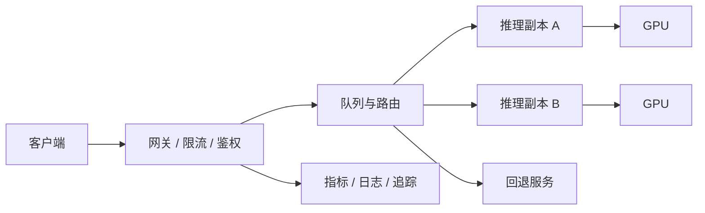

# 推理与基础设施

推理系统把模型权重转化为在线能力。生产优化的目标不是单项跑分最高，而是在质量不退化的前提下，让延迟、吞吐、稳定性和成本共同达到要求。

## 推理工作负载

| 类型         | 典型场景                      | 关注重点                    |
| ------------ | ----------------------------- | --------------------------- |
| 离线批处理   | 批量摘要、Embedding、数据标注 | 总吞吐、完成时间、可恢复性  |
| 在线非流式   | 分类、结构化抽取              | 整体延迟、并发、稳定性      |
| 在线流式生成 | 对话、代码补全                | 首 Token 延迟、Token 间延迟 |
| 实时多模态   | 语音对话、视频理解            | 端到端时延、抖动、同步      |

## 必须理解的指标

- **TTFT（Time to First Token）**：从请求到首个输出 Token 的时间。
- **ITL / TPOT**：生成过程中相邻 Token 的间隔或每 Token 时间。
- **TPS**：每秒生成 Token 数，必须说明按单请求还是整个服务统计。
- **吞吐**：单位时间完成的请求或 Token 数。
- **并发数**：同时处理的活跃请求。
- **P50 / P95 / P99**：不同分位数延迟，尾部延迟往往决定用户体验。
- **Goodput**：在延迟目标内成功完成的有效吞吐。
- **单位成功任务成本**：总资源成本除以满足质量与延迟门槛的任务数。

只比较“每秒 Token”容易误导：更高并发可能提升总吞吐，却让单个用户等待更久。

## 显存花在了哪里

推理显存大致由以下部分组成：

```text
模型权重 + KV Cache + 运行时工作区 + 输入输出缓冲 + 框架开销
```

- 模型越大、权重精度越高，权重占用越大。
- 上下文越长、并发越高，KV Cache 通常越大。
- 多模态编码、长序列和复杂解码会增加临时内存。
- 显存碎片和预留空间也会让理论容量与实际容量不同。

容量规划必须使用真实输入长度和输出长度分布，不能只用平均值。

## 常见优化手段

| 手段                  | 收益                       | 代价 / 风险                        |
| --------------------- | -------------------------- | ---------------------------------- |
| 量化                  | 降低显存和计算成本         | 可能损失质量，硬件和算子兼容性不同 |
| 动态 / 连续批处理     | 提升 GPU 利用率和吞吐      | 调度更复杂，可能增加排队延迟       |
| KV Cache 管理         | 支持更高并发和更长上下文   | 容量控制与淘汰更复杂               |
| 前缀缓存              | 复用相同系统指令或文档前缀 | 缓存命中、隔离和失效要正确         |
| 推测解码              | 用小模型或草稿加速生成     | 模型组合和命中率决定收益           |
| 张量 / 流水线并行     | 部署单卡放不下的模型       | 跨卡通信会影响延迟                 |
| 数据并行副本          | 提升并发和可用性           | 权重复制增加资源占用               |
| Prefill / Decode 分离 | 分别调度输入计算和生成计算 | 架构与网络复杂度上升               |

优化必须在固定质量门槛下比较。量化后如果任务成功率下降，单位成功任务成本可能反而更高。

## 服务架构



关键机制包括健康检查、就绪检查、过载保护、请求排队、超时、熔断、优先级、公平调度和优雅终止。自动扩容要同时观察排队长度、GPU 利用率、延迟和冷启动时间。

## 工具如何分工

- [vLLM](https://docs.vllm.ai/en/latest/serving/online_serving/)：面向大语言模型的高吞吐推理与在线服务，支持兼容 OpenAI 风格的服务接口。
- [NVIDIA Triton Inference Server](https://docs.nvidia.com/deeplearning/triton-inference-server/user-guide/docs/user_guide/architecture.html)：适合统一服务不同框架和模型，提供模型仓库、调度、批处理、HTTP / gRPC 与指标能力。
- [Ray Serve LLM](https://docs.ray.io/en/latest/serve/llm/index.html)：适合分布式、多节点、多模型和可组合的服务场景，并提供自动扩缩等能力。

这些工具可以组合，也可能互相替代。先确定负载、SLO、硬件和团队运维边界，再做选型。

## 基准测试方法

1. 固定模型、精度、硬件、服务参数和软件版本。
2. 使用接近生产的输入 / 输出长度分布，而不是单一短提示词。
3. 分别测试低并发、目标并发和过载状态。
4. 记录质量、错误率、TTFT、ITL、端到端分位延迟、吞吐和功耗 / 成本。
5. 预热后再计数，同时保留冷启动测试。
6. 对每个配置重复测试并给出波动范围。
7. 将结果换算为满足 SLO 的最大容量和单位成功任务成本。

## 容量与发布

容量估算要预留峰值、故障转移和发布冗余。不要按 GPU 在平均负载下 100% 使用来设计生产系统。

发布时采用影子流量或小比例灰度，比较新旧版本的质量、延迟、错误率和成本。模型权重、推理引擎、量化方式、GPU 驱动或批处理参数发生变化，都应视为一次需要回归测试的发布。

## 上线检查清单

- 有明确的 SLO、最大输入 / 输出长度和并发上限。
- 超载时会快速拒绝或降级，而不是拖垮所有请求。
- 指标可按模型版本、租户、任务和硬件切片。
- 模型加载失败、GPU 故障和依赖超时都有告警与恢复方案。
- 发布可以灰度，旧版本权重和配置可以快速回滚。
- 容量与成本基于真实流量测试，而非理论峰值。
