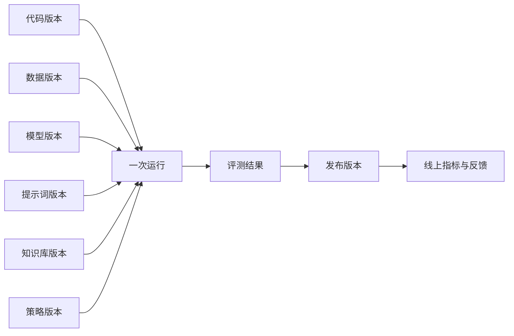
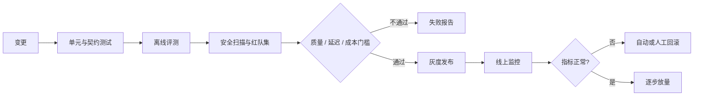

# LLMOps：让 AI 系统可持续迭代

传统软件主要管理代码和依赖，AI 系统还要管理数据、模型、提示词、知识库、评测集和安全策略。LLMOps 的目标，是让任何线上行为都能追溯、比较、发布和回滚。

## 版本关系图

如果一次线上错误无法还原这张关系图，就很难真正修复问题。

## LLMOps 与 MLOps 的关系

LLMOps 继承了 MLOps 的数据、实验、模型注册、部署和监控能力，又增加了：

- 提示词、上下文和模型 API 版本管理。
- 非确定生成结果的评测与回归。
- RAG 检索链路、引用和知识库版本。
- 工具调用、Agent 轨迹和多步骤成本。
- 第三方模型供应商的变更与回退。
- 提示词注入、数据外泄和内容安全防护。

## 研发阶段：追踪实验

一次实验至少记录：

| 类别 | 内容                                    |
| ---- | --------------------------------------- |
| 输入 | 数据集与评测集版本、抽样规则            |
| 配置 | 模型、提示词、解码参数、检索和工具配置  |
| 环境 | 代码提交、依赖、镜像、硬件              |
| 结果 | 质量指标、分切片指标、延迟、Token、成本 |
| 产物 | 模型权重、Adapter、索引、报告           |
| 结论 | 假设是否成立、已知失败、下一步          |

给实验命名不是为了整齐，而是为了让团队在数周后仍能解释“为什么发布这个版本”。

## 提示词与配置管理

提示词应像代码一样经过：草稿 → 评测 → 评审 → 灰度 → 正式别名 → 回滚。业务系统引用稳定别名，发布系统再把别名指向不可变版本。

MLflow 的 [Prompt Registry](https://www.mlflow.org/genai/prompt-registry/)展示了提示词版本、比较、评测和别名管理的思路。无论使用什么工具，都应避免直接覆盖生产提示词。

## 评测体系

完整评测由多层组成：

1. **确定性测试**：Schema、权限、引用、工具参数和业务规则。
2. **任务指标**：准确率、召回率、成功率、通过率等。
3. **模型评审**：对相关性、完整性、风格等开放指标评分。
4. **人工评审**：领域专家处理高风险和主观问题。
5. **安全红队**：越权、注入、隐私、恶意工具调用。
6. **在线实验**：在风险可控时验证真实用户价值。

模型评审器本身也有偏差，应通过人工样本校准，固定版本，并定期测量与人工判断的一致性。

## 可观测性

对一次请求，建议形成一条端到端 Trace：网关 → 应用编排 → 检索 → 重排 → 模型调用 → 工具执行 → 输出校验。每个 Span 记录必要的耗时、状态、版本和用量。

观察四类信号：

- **质量**：任务成功率、引用正确率、拒答和人工接管率。
- **性能**：端到端延迟、TTFT、工具延迟、队列时间。
- **可靠性**：错误率、超时率、重试率、回退率。
- **经济性**：输入 / 输出 Token、GPU 用量、缓存命中、单任务成本。

[OpenTelemetry 语义约定](https://opentelemetry.io/docs/specs/semconv/)提供跨系统统一命名的思路；生成式 AI 相关约定仍在演进，落地时要固定所采用的版本。

不要默认记录完整提示词、文档和工具返回。先做数据分类、脱敏、采样与访问控制，保留调试价值的同时减少隐私风险。

## 持续交付流水线

发布门槛要包含不可退化指标，例如核心任务成功率、安全通过率、P95 延迟和单位成本。综合分提高，不能抵消某个高风险切片的明显退化。

## 线上漂移与反馈

漂移可能来自用户分布、文档、模型 API、检索索引、工具接口或攻击方式变化。可监控：

- 输入语言、长度、主题和用户群体分布。
- 检索无结果率、低相似度率、过期引用率。
- 输出长度、拒答、重试、人工接管和投诉类型。
- 模型供应商版本或行为变化。

线上反馈先进入隔离区，经过脱敏、归因和复核，再进入评测或训练流程。不要把点赞 / 点踩直接当作可靠标签。

## 事故响应

发生质量、安全或成本事故时：

1. 按租户、模型、提示词、数据和工具版本定位影响范围。
2. 立即限流、关闭高风险工具、切换回退模型或回滚发布。
3. 保存经过权限控制的必要证据，避免二次泄露。
4. 将事故样本转为回归测试。
5. 修复根因，并更新监控、门槛和运行手册。

[MLflow GenAI](https://mlflow.org/docs/latest/genai/)覆盖追踪、评测、提示词管理等生命周期能力，可作为理解一体化平台的参考。工具可以不同，但版本链、证据链和发布门槛不可缺失。

## 最小落地清单

- 代码、数据、模型、提示词、知识库和安全策略都有不可变版本。
- 每次发布都有评测报告和审批记录。
- 每个线上请求能追踪到完整版本组合。
- 有质量、性能、可靠性与成本四类看板。
- 支持灰度、回退、快速止损和事故复盘。
- 线上反馈不会未经治理直接进入训练。
