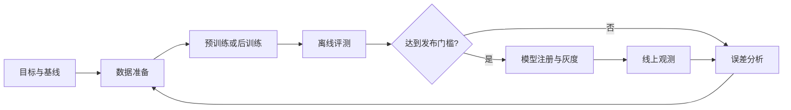

# 模型研发与后训练

模型研发的目标不是单纯降低训练损失，而是让模型在明确任务上，以可接受的成本和风险稳定工作。完整过程通常包含基线、数据、训练、评测、发布和反馈。

## 先判断是否真的需要训练

| 问题                                   | 优先方案                 | 原因                         |
| -------------------------------------- | ------------------------ | ---------------------------- |
| 模型不知道最新或私有事实               | RAG / 工具查询           | 知识可更新、可引用、可撤回   |
| 输出格式或语气不稳定                   | 提示词、示例、结构化输出 | 成本低，迭代快               |
| 需要稳定学习领域行为或风格             | 监督微调 SFT             | 把大量示例沉淀为模型行为     |
| 希望优化人类偏好或特定奖励             | 偏好优化 / 强化学习      | 能直接优化相对偏好或奖励信号 |
| 目标领域、语言或架构与现有模型差异巨大 | 继续预训练或从头预训练   | 改变底层知识和表示能力       |

推荐顺序通常是：**基线 → 提示词 → 检索 / 工具 → 微调 → 继续预训练 → 从头训练**。越靠后，对数据、算力和团队能力的要求越高。

## 预训练与继续预训练

预训练让模型在大规模语料上学习通用表示和生成能力。核心工作包括：

- 定义词表、架构、上下文长度和训练目标。
- 建立合规且可追溯的数据混合与采样策略。
- 进行分布式训练、混合精度计算、检查点保存与故障恢复。
- 监控损失、梯度、吞吐、数据异常和验证集指标。
- 评估能力增长、安全风险、记忆与数据污染。

继续预训练通常从已有模型开始，使用领域或新增语言数据进一步训练。它可能增强领域表达，也可能造成通用能力退化，因此要保留通用能力回归集。

## 监督微调 SFT

监督微调使用“输入—理想输出”示例，让模型学习指令遵循、特定格式、领域表达或工具调用模式。

高质量 SFT 数据应具备：

1. 指令明确，答案由领域专家或严格流程验证。
2. 覆盖主要场景、边界场景、拒答场景和多轮状态。
3. 输入与输出格式和真实生产请求一致。
4. 去重并隔离验证集、测试集，避免数据泄漏。
5. 保留来源、许可、版本和清洗记录。

不要用大量低质量合成数据覆盖少量高质量人工样本。合成数据适合扩充覆盖面，但必须抽样审查，并检测模式坍缩、事实错误和标签偏差。

## 偏好优化与强化学习

后训练方法解决的是“多个可接受答案中，哪一个更符合目标”的问题。

| 方法类别            | 训练信号                 | 适合场景                         | 关键风险               |
| ------------------- | ------------------------ | -------------------------------- | ---------------------- |
| 奖励模型 + 强化学习 | 奖励分数                 | 可定义复杂行为目标               | 奖励投机、训练不稳定   |
| DPO 等直接偏好优化  | 偏好对                   | 有较稳定的人类或模型偏好数据     | 偏好数据偏差、过拟合   |
| GRPO 等组内相对优化 | 同一问题多答案的相对奖励 | 可自动验证的推理、代码或数学任务 | 奖励设计失真、能力偏科 |

不同算法只是优化手段。真正决定上限的往往是任务定义、偏好数据和评测质量。可以参考 [TRL 官方文档](https://huggingface.co/docs/trl/index)了解当前支持的后训练方法。

## 参数高效微调

全量微调会更新全部模型参数，显存、存储和训练成本较高。PEFT 只训练少量附加或选定参数，常见方法包括 LoRA、Adapter 和 Prompt Tuning。

- **LoRA**：用低秩矩阵表示权重更新，应用广泛。
- **QLoRA**：对基础模型量化，同时训练 LoRA 参数，进一步降低显存需求。
- **多 Adapter**：一个基础模型加载多个领域适配器，便于复用，但要评估切换和服务开销。

PEFT 降低的是资源门槛，不会自动修复坏数据、错误标签或不合理目标。原理和接口可参考 [Hugging Face PEFT](https://huggingface.co/docs/peft/index)。

## 分布式训练基础

模型或批次无法放入单个设备时，常见并行方式包括：

- **数据并行**：每个设备持有模型副本，处理不同数据。
- **张量并行**：把单层矩阵计算拆到多个设备。
- **流水线并行**：把不同网络层放在不同设备。
- **参数分片**：将参数、梯度和优化器状态分散保存。

PyTorch FSDP 提供参数分片能力，详见 [FSDP 官方文档](https://docs.pytorch.org/docs/stable/fsdp.html)。实际方案还要考虑网络带宽、节点故障、检查点格式和训练恢复时间。

## 评测与误差分析

训练期间至少维护四类指标：

| 指标     | 目的                                     |
| -------- | ---------------------------------------- |
| 优化指标 | 损失、学习率、梯度范数，判断训练是否稳定 |
| 任务指标 | 准确率、召回率、通过率或领域评分         |
| 能力回归 | 确认微调后没有破坏通用能力               |
| 安全指标 | 有害输出、越权、隐私泄露、偏见与拒答质量 |

不要只汇报一个总分。把失败样本按原因分类，例如事实错误、推理错误、格式错误、拒答错误、工具参数错误，才能决定下一轮该改数据、训练还是应用逻辑。

## 可复现训练清单

每个模型版本至少记录：

- 基础模型名称、权重哈希、许可证与来源。
- 训练代码提交、依赖和容器镜像版本。
- 数据集版本、过滤规则、采样比例和切分方式。
- 随机种子、超参数、硬件拓扑和训练时长。
- 检查点、评测集版本、结果与已知限制。
- 负责人、审批记录、发布日期和回滚目标。

发布时配套模型卡，说明用途、训练数据概况、评测结果、不适用场景和安全限制。模型文件只是研发产物的一部分，证据链同样重要。
