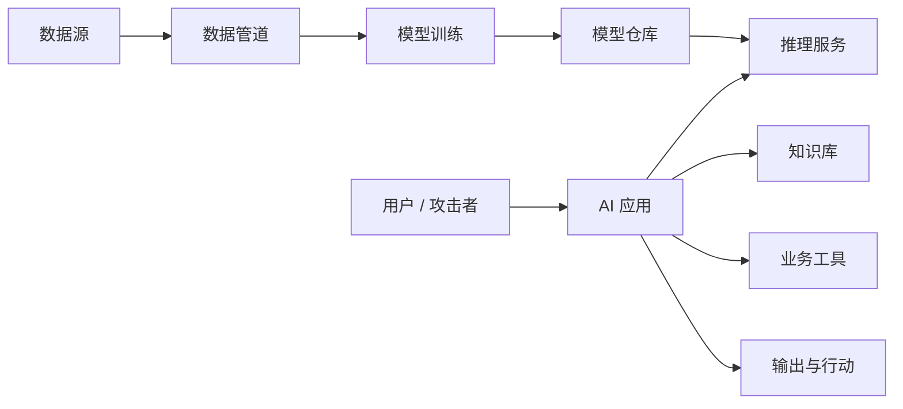

# AI 安全与治理

AI 安全不是在模型外加一个敏感词列表，而是覆盖数据、模型、依赖、应用、工具、基础设施和人的全生命周期控制。

## 建立威胁模型

逐个节点回答：资产是什么、谁能访问、输入是否可信、最坏后果是什么、如何发现和止损。

## 主要风险面

| 风险面     | 例子                               | 关键控制                                 |
| ---------- | ---------------------------------- | ---------------------------------------- |
| 数据       | 未授权训练、个人信息泄露、数据投毒 | 来源与许可、脱敏、访问控制、质量审查     |
| 模型供应链 | 恶意权重、危险自定义代码、依赖污染 | 可信来源、哈希、签名、隔离扫描、许可审查 |
| 应用输入   | 越狱、直接或间接提示词注入         | 指令与数据隔离、最小权限、输出和工具校验 |
| RAG        | 恶意文档、跨租户检索、过期内容     | 摄取审查、权限过滤、来源引用、删除同步   |
| 工具       | 越权、参数注入、重复执行           | 窄接口、服务端鉴权、幂等、审批、审计     |
| 输出       | 有害内容、错误建议、代码或链接攻击 | 内容策略、事实核验、沙箱、人工复核       |
| 运维       | 密钥泄露、日志含敏感数据、资源滥用 | 密钥管理、日志脱敏、限额、异常检测       |

## 提示词注入

提示词注入的本质是：系统把不可信数据误当成了指令。攻击内容可能来自用户消息，也可能藏在网页、邮件、文档、图片 OCR 或工具返回中。

核心防护原则：

- 把系统指令、用户输入、检索内容和工具结果明确分层。
- 外部内容只作为数据，不授予其改变策略或权限的能力。
- 模型无权自行扩大工具权限；服务端始终重新鉴权。
- 对敏感工具使用允许列表、参数约束、确认和审批。
- 对输出中的秘密、个人信息、恶意链接和可执行内容做检查。
- 为失败设置费用、Token、工具次数和总时长上限。

提示词中的“忽略恶意指令”只能作为辅助，不能替代系统边界。更完整的防护建议可参考 [OWASP LLM Prompt Injection Prevention Cheat Sheet](https://cheatsheetseries.owasp.org/cheatsheets/LLM_Prompt_Injection_Prevention_Cheat_Sheet.html)。

## 模型与依赖供应链

下载开放权重或数据集时：

1. 从可信仓库获取并固定精确版本或提交。
2. 验证哈希或签名，不使用会漂移的 latest。
3. 优先使用只保存张量的安全格式，谨慎加载可执行序列化文件。
4. 禁止或隔离运行仓库附带的自定义代码。
5. 扫描容器、Python 依赖和系统包漏洞。
6. 审查模型、数据和代码许可证是否兼容商业用途。
7. 在隔离环境评测后再进入内部模型仓库。

模型文件可能很大，但它仍然是供应链产物，不能因为来源热门就跳过验证。

## 隐私与数据保护

按数据生命周期治理：采集 → 传输 → 处理 → 日志 → 缓存 → 索引 → 训练 → 备份 → 删除。

- 只收集任务必需的数据，并明确用途和保留期。
- 根据敏感等级选择可使用的模型、区域和供应商。
- 密钥和身份凭证不进入提示词或普通日志。
- 对调试数据进行脱敏、抽样和访问审批。
- 支持用户数据访问、更正和删除，并同步清理派生索引。
- 评估成员推断、训练数据记忆和模型反演等风险。

## 人在回路

人工审批适用于高影响、不可逆或法律责任明确的动作，例如资金、医疗、招聘、权限变更和对外发布。审批界面需要展示：模型建议、关键证据、风险提示、将要执行的动作和可修改参数。

“点确认”不等于有效监督。审核者要有时间、信息和真正拒绝或修改结果的能力。

## 风险分级

可以从四个维度给场景分级：

- **影响**：错误会造成多大人身、财务、权益或声誉损失？
- **可逆性**：动作能否撤回或补偿？
- **自主性**：模型只是建议，还是可以直接行动？
- **暴露面**：内部少量用户，还是面向公众和攻击者？

风险越高，越需要更强的证据、人工审批、隔离环境、审计、红队和持续监控。

## 治理闭环

[NIST AI Risk Management Framework](https://www.nist.gov/itl/ai-risk-management-framework)将风险管理组织为四类功能：

- **Govern**：建立政策、职责、文化和问责。
- **Map**：理解使用场景、相关方、影响和风险背景。
- **Measure**：通过评测、测试和监控衡量风险。
- **Manage**：确定优先级，实施控制并持续改进。

治理不是一次审批，而是贯穿采购、研发、上线、变更和退役的闭环。

## 红队测试

红队样本至少覆盖：

- 直接越狱、角色扮演、编码混淆和多轮诱导。
- 网页、文档、图片和工具结果中的间接注入。
- 跨租户数据访问、秘密提取和提示词泄露。
- 工具越权、参数操纵、重复执行和高成本循环。
- 有害建议、偏见、过度拒答和危险代码。
- 长上下文、异常文件、并发和资源耗尽。

每次事故和新攻击都应沉淀为自动化回归样本，并保留人工红队探索未知风险。

## 上线前治理材料

- 场景说明、预期用户、禁止用途和风险等级。
- 数据清单、授权依据、保留期和删除机制。
- 模型卡、供应链清单、评测与红队报告。
- 人工审批点、申诉和用户反馈机制。
- 线上监控、事故响应、回滚和停用方案。
- 负责人、复审周期和变更记录。

安全目标不是让模型“永不出错”，而是让系统在出错或被攻击时仍然守住权限、数据和业务后果。
