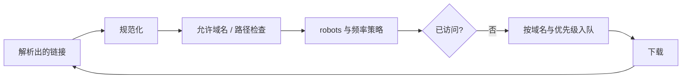

# 并发、限速与请求调度

爬虫大多是 I/O 密集任务：程序经常在等待网络。并发可以利用等待时间，但并发数、请求速率和服务器承载能力是三个不同概念。

> 并发不是越高越好。正确目标是在站方允许范围内，以最低失败率稳定完成任务。

## 并发模型怎么选

| 模型              | 适合场景                     | 优点                           | 注意点                         |
| ----------------- | ---------------------------- | ------------------------------ | ------------------------------ |
| 顺序执行          | 小任务、调试、低频同步       | 最简单、影响最小               | 总时间较长                     |
| 线程池            | 已有同步 Requests 代码       | 改造成本低                     | 每线程资源、共享状态、连接管理 |
| asyncio + aiohttp | 大量 I/O、精细控制           | 单进程支持高并发               | 异步调用链、背压和取消处理     |
| Scrapy            | 多页递归、长期项目           | 调度、去重、Pipeline、统计完善 | 要遵循框架生命周期             |
| 进程池            | CPU 密集解析、压缩或图像处理 | 利用多核                       | 序列化和进程通信成本           |

不要用进程池解决网络等待，也不要为了几十个页面引入分布式系统。

## 线程池

```python
from concurrent.futures import ThreadPoolExecutor, as_completed

import requests


def fetch(url: str) -> tuple[str, int]:
    response = requests.get(url, timeout=(5, 20))
    response.raise_for_status()
    return response.url, len(response.content)


urls = [
    "https://example.com/a",
    "https://example.com/b",
]

with ThreadPoolExecutor(max_workers=4) as executor:
    future_to_url = {executor.submit(fetch, url): url for url in urls}
    for future in as_completed(future_to_url):
        source_url = future_to_url[future]
        try:
            final_url, size = future.result()
        except requests.RequestException as error:
            print(f"失败 {source_url}: {error}")
        else:
            print(final_url, size)
```

Python 标准库的 [concurrent.futures](https://docs.python.org/3/library/concurrent.futures.html)提供统一的 Future 接口。线程中不要无保护地共享可变数据或一个全局 Session；可以用线程本地 Session，或让每个任务返回结果，由主线程统一写入。

## asyncio 与 aiohttp

下面示例同时限制总连接、单域名连接和请求起始间隔：

```python
import asyncio
from time import monotonic

import aiohttp


class Pacer:
    def __init__(self, interval_seconds: float) -> None:
        self.interval = interval_seconds
        self._next_at = 0.0
        self._lock = asyncio.Lock()

    async def wait(self) -> None:
        async with self._lock:
            now = monotonic()
            delay = max(0.0, self._next_at - now)
            if delay:
                await asyncio.sleep(delay)
            self._next_at = monotonic() + self.interval


async def fetch(
    session: aiohttp.ClientSession,
    semaphore: asyncio.Semaphore,
    pacer: Pacer,
    url: str,
) -> tuple[str, str]:
    await pacer.wait()
    async with semaphore:
        async with session.get(url) as response:
            response.raise_for_status()
            return str(response.url), await response.text()


async def main(urls: list[str]) -> list[tuple[str, str]]:
    timeout = aiohttp.ClientTimeout(total=30, connect=5, sock_read=20)
    connector = aiohttp.TCPConnector(limit=20, limit_per_host=4)
    semaphore = asyncio.Semaphore(10)
    pacer = Pacer(interval_seconds=0.5)

    async with aiohttp.ClientSession(
        timeout=timeout,
        connector=connector,
        headers={"User-Agent": "CatalogSync/1.2 (contact: data-team@example.com)"},
        raise_for_status=True,
    ) as session:
        async with asyncio.TaskGroup() as group:
            tasks = [
                group.create_task(fetch(session, semaphore, pacer, url))
                for url in urls
            ]

        return [task.result() for task in tasks]
```

aiohttp 的连接器提供总连接和每端点连接上限，参见[官方 Client Reference](https://docs.aiohttp.org/en/stable/client_reference.html#connectors)。`TaskGroup` 会在退出上下文时等待任务完成，并在子任务失败时提供结构化取消语义。

该示例适合单一域名；多域名任务应为每个域名维护独立的 Pacer、并发上限和 robots 策略。

## 并发、速率和背压

- **并发上限**：同时在途的请求数量。
- **速率上限**：每秒或每分钟最多启动多少请求。
- **突发容量**：是否允许短时间集中请求。
- **背压**：下游处理不过来时，上游停止继续生产任务。

Semaphore 只限制并发，不保证每秒请求数。连接池只限制连接，也不等于业务速率。生产系统应使用 Token Bucket、Leaky Bucket 或明确的调度器实现速率策略。

## 有界队列

无界地创建几十万个协程会耗尽内存。使用固定 Worker 和有界队列：

```python
import asyncio


async def worker(queue: asyncio.Queue[str]) -> None:
    while True:
        url = await queue.get()
        try:
            await process(url)
        finally:
            queue.task_done()


async def run(urls: list[str]) -> None:
    queue: asyncio.Queue[str] = asyncio.Queue(maxsize=1_000)
    workers = [asyncio.create_task(worker(queue)) for _ in range(5)]

    try:
        for url in urls:
            await queue.put(url)  # 队列满时等待，形成背压
        await queue.join()
    finally:
        for task in workers:
            task.cancel()
        await asyncio.gather(*workers, return_exceptions=True)
```

示例中的 `process()` 应包含超时、域名策略和错误处理。真实任务还要把未完成队列持久化，进程退出后才能恢复。

## URL Frontier

递归爬虫需要维护待抓取集合，即 URL Frontier：



去重键通常来自规范化 URL，但要谨慎处理：查询参数顺序、默认端口、Fragment、大小写和跟踪参数。错误规范化可能把不同内容合并，也可能造成无限重复。

## 重试队列与死信

将失败分为：

- 可立即重试：短暂连接中断，次数必须很少。
- 延迟重试：429、503，根据 `Retry-After` 或退避时间重新入队。
- 永久失败：无权限、资源删除、Schema 不兼容。
- 需要人工：授权改变、robots 改变、异常大规模字段缺失。

超过阈值的任务进入死信队列，保留原因、尝试次数和下次处理建议，不要丢弃或无限重试。

## 自适应限速

可以根据延迟和错误率降低速率，但不要用它试探站点极限：

- 429 或 `Retry-After`：立即减速或暂停。
- P95 延迟上升、5xx 增多：降低并发并延长间隔。
- 稳定恢复后：缓慢回到经过批准的上限。
- 授权或 robots 改变：停止，不自动“适应”。

## 容量估算

粗略吞吐受平均响应时间、并发上限和速率上限共同约束：

```text
并发可支持的吞吐 ≈ 并发数 / 平均响应时间
实际吞吐 ≤ min(并发可支持吞吐, 站方允许速率, 下游处理能力)
```

用真实响应大小、延迟分布和解析成本做压测，并优先在自有测试环境进行。
