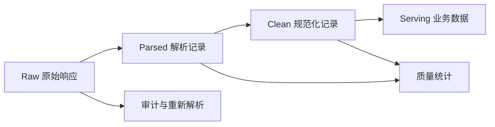

# 数据存储、增量与质量

爬虫输出不是“抓到什么就存什么”。先定义数据消费者、Schema、唯一键、新鲜度和删除规则，再选择存储形式。

## 数据分层



- **Raw**：经授权保留的原始响应、状态和获取元数据。
- **Parsed**：从某个解析器版本得到的字段。
- **Clean**：类型、枚举、单位和唯一键已规范化。
- **Serving**：面向搜索、分析或业务应用的数据。

原始响应可能包含个人信息、脚本或秘密，不能因为“方便调试”就无限期保存。

## Schema 设计

```python
from dataclasses import dataclass
from datetime import datetime
from decimal import Decimal


@dataclass(frozen=True)
class ProductRecord:
    source: str
    external_id: str
    name: str
    price: Decimal | None
    currency: str | None
    source_url: str
    fetched_at: datetime
    content_hash: str
    parser_version: str
```

建议每条记录都有：来源、外部唯一 ID、源 URL、获取时间、内容哈希和解析器版本。这样才能回答“这条数据来自哪里、何时获取、用什么代码解析”。

## 存储选择

| 存储       | 适合                       | 优点                       | 注意点                       |
| ---------- | -------------------------- | -------------------------- | ---------------------------- |
| JSONL      | 原始记录、数据交换、批处理 | 一行一条，流式友好         | 查询和约束较弱               |
| CSV        | 扁平表格和人工查看         | 通用                       | 嵌套结构、类型和换行容易出错 |
| Parquet    | 大规模分析数据             | 列式压缩、类型明确         | 不适合频繁单行更新           |
| SQLite     | 单机项目、原型、测试       | 无独立服务、支持事务与 SQL | 写并发和超大规模有限         |
| PostgreSQL | 关系数据、并发服务         | 约束、索引、事务完善       | 需要部署和运维               |
| 对象存储   | HTML、图片、批次文件       | 便宜、可版本化、适合大对象 | 需要单独的元数据索引         |

Python 标准库自带 `sqlite3`，适合从原型开始，参见[官方文档](https://docs.python.org/3/library/sqlite3.html)。

## SQLite 幂等写入

```python
import sqlite3

SCHEMA = """
CREATE TABLE IF NOT EXISTS products (
    source TEXT NOT NULL,
    external_id TEXT NOT NULL,
    name TEXT NOT NULL,
    price TEXT,
    currency TEXT,
    source_url TEXT NOT NULL,
    fetched_at TEXT NOT NULL,
    content_hash TEXT NOT NULL,
    parser_version TEXT NOT NULL,
    PRIMARY KEY (source, external_id)
)
"""

UPSERT = """
INSERT INTO products (
    source, external_id, name, price, currency,
    source_url, fetched_at, content_hash, parser_version
) VALUES (?, ?, ?, ?, ?, ?, ?, ?, ?)
ON CONFLICT(source, external_id) DO UPDATE SET
    name = excluded.name,
    price = excluded.price,
    currency = excluded.currency,
    source_url = excluded.source_url,
    fetched_at = excluded.fetched_at,
    content_hash = excluded.content_hash,
    parser_version = excluded.parser_version
"""

with sqlite3.connect("var/crawler.db") as connection:
    connection.execute(SCHEMA)
    connection.execute(
        UPSERT,
        (
            "catalog",
            "42",
            "机械键盘",
            "399.00",
            "CNY",
            "https://example.com/products/42",
            "2026-10-06T08:00:00Z",
            "sha256:...",
            "git:abc123",
        ),
    )
```

使用参数化 SQL，不要用字符串拼接数据。事务提交成功后再推进任务水位。

## 唯一键与去重

优先使用来源提供的稳定 ID。没有稳定 ID 时，可组合业务字段或计算规范化内容哈希，但要记录规则版本。

```python
from hashlib import sha256
import json


def stable_hash(record: dict) -> str:
    payload = json.dumps(
        record,
        ensure_ascii=False,
        sort_keys=True,
        separators=(",", ":"),
    ).encode("utf-8")
    return sha256(payload).hexdigest()
```

不要用整页 HTML 哈希判断业务内容变化：时间戳、广告和随机 ID 可能让每次哈希都不同。对经过定义的业务字段计算哈希更稳定。

## 新增、更新与删除

增量同步至少区分：

- **新增**：从未见过的唯一键。
- **更新**：同一键的业务字段或版本改变。
- **未变化**：内容哈希相同，只更新最后检查时间。
- **删除 / 下架**：来源明确返回删除，或连续多次全量快照均未出现。

不要因为一次请求失败就把已有记录标记为删除。删除判断需要来源语义和成功快照证据。

## 原始响应与血缘

原始响应元数据可包含：

```text
request_id、requested_url、final_url、status_code
fetched_at、content_type、encoding、etag、last_modified
body_hash、storage_key、crawler_version、policy_version
```

如果保存响应体，应加密、控制访问、设置保留期，并根据内容类型和敏感级别决定是否允许保存。

## 数据质量规则

| 维度   | 示例指标                             |
| ------ | ------------------------------------ |
| 完整性 | 必填字段非空率、列表覆盖率           |
| 有效性 | 价格范围、日期格式、URL Scheme       |
| 唯一性 | 主键冲突率、内容重复率               |
| 一致性 | 详情与列表字段一致率、货币与价格匹配 |
| 新鲜度 | 来源更新时间到入库时间的延迟         |
| 稳定性 | 每页记录数、字段长度和枚举分布变化   |

质量规则需要硬失败和软告警两类。主键缺失、越权数据应阻止入库；轻微分布变化可以先告警和抽样检查。

## 批次发布

不要让消费者看到半批数据：

1. 创建批次 ID，并记录开始时间和配置版本。
2. 写入暂存区，运行 Schema 与质量校验。
3. 校验通过后，在事务中合并或切换版本。
4. 发布成功后推进水位。
5. 失败批次保留诊断信息，但不进入业务表。

批次机制让“抓取成功”和“数据可用”成为两个明确状态。
