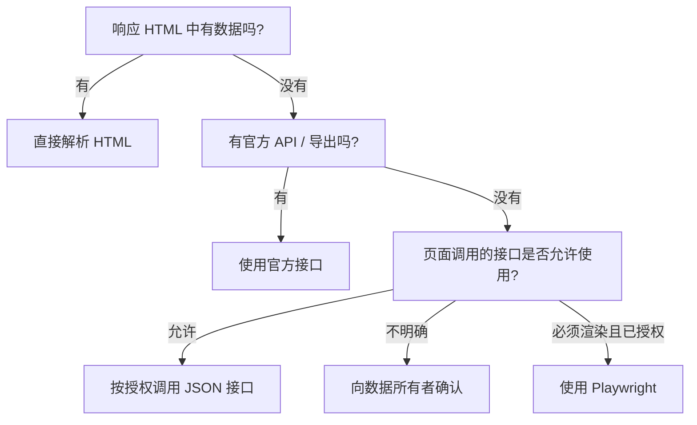

# 动态网页与 Playwright

动态页面会在初始 HTML 返回后，通过 JavaScript 请求数据并修改 DOM。浏览器自动化能处理这类页面，但 CPU、内存、网络和运维成本都明显更高。

## 使用浏览器前的决策顺序



验证码、登录挑战或访问拒绝是需要停止和确认授权的信号，不是要被技术绕过的障碍。

## 安装

```bash
python -m pip install playwright
python -m playwright install chromium
```

浏览器二进制较大，CI 和容器环境要固定 Playwright 与浏览器版本，并使用官方支持的安装流程。

## 第一个动态页面采集器

```python
from playwright.sync_api import sync_playwright

URL = "https://quotes.toscrape.com/js/"

with sync_playwright() as playwright:
    browser = playwright.chromium.launch(headless=True)
    context = browser.new_context(
        user_agent="LearningCrawler/1.0 (contact: you@example.com)",
        locale="zh-CN",
    )
    page = context.new_page()
    page.goto(URL, wait_until="domcontentloaded", timeout=30_000)

    quotes = page.locator("div.quote")
    quotes.first.wait_for(state="visible", timeout=10_000)

    rows = []
    for index in range(quotes.count()):
        quote = quotes.nth(index)
        rows.append(
            {
                "text": quote.locator("span.text").inner_text().strip(),
                "author": quote.locator("small.author").inner_text().strip(),
                "source_url": page.url,
            }
        )

    context.close()
    browser.close()
```

官方文档说明 Locator 是 Playwright 自动等待和重试能力的核心。更推荐按角色、标签或稳定业务属性定位；长 CSS / XPath 路径容易随 DOM 变化而失效。参见 [Playwright Locators](https://playwright.dev/python/docs/locators)。

## 正确等待

不要用固定 `time.sleep(5)` 猜测页面何时完成。应等待业务条件：

```python
page.goto(url, wait_until="domcontentloaded")
page.get_by_role("heading", name="商品列表").wait_for()
page.locator("[data-testid='product-card']").first.wait_for()
```

`networkidle` 并不总可靠：长连接、分析脚本和轮询请求可能让网络永远不空闲。最稳妥的是等待“页面已经满足可解析条件”的具体元素或响应。

## 等待授权接口响应

当一次点击会触发已获准使用的 JSON 请求时，可以等待对应响应：

```python
with page.expect_response(
    lambda response: "/api/search" in response.url and response.status == 200
) as response_info:
    page.get_by_role("button", name="搜索").click()

payload = response_info.value.json()
```

这比从渲染后的卡片重新拼数据更稳定，但仍需确认接口使用边界并校验响应。

## Browser、Context 与 Page

- **Browser**：浏览器进程，启动成本最高。
- **BrowserContext**：隔离的会话环境，可分别拥有 Cookie、缓存和权限。
- **Page**：Context 中的标签页。

可复用 Browser，但不同账号或租户使用独立 Context。限制同时打开的 Page 数，并确保异常时也能关闭资源。

## 登录状态

Playwright 可以保存 `storage_state`，其中可能包含可直接登录的 Cookie 或 Token：

```python
context.storage_state(path="state.json")
```

这个文件属于敏感凭证，不应提交到代码库。设置严格文件权限、短保留期和专用低权限账号。多因素认证、验证码和风险确认交给官方认证流程或人工处理。

## 减少浏览器成本

- 首次分析可使用浏览器，稳定后尽量改为获准的 JSON 或 HTML 请求。
- 复用 Browser，按任务创建和销毁 Context。
- 只在必要场景加载图片、字体等资源；确认不会改变业务行为。
- 限制页面数量、导航次数、超时和每个任务的总时长。
- 对失败页面保存经脱敏的截图、HTML 和 Trace，并设置保留期。

## 常见失败

| 现象                | 可能原因                       | 正确处理                                  |
| ------------------- | ------------------------------ | ----------------------------------------- |
| Locator 找不到      | 页面未完成、iframe、选择器变化 | 等待业务条件，检查 Frame 和保存的页面样本 |
| 偶发超时            | 后端慢、资源多、并发过高       | 降低并发，区分导航与元素超时              |
| 本地成功、CI 失败   | 字体、区域、版本或资源不足     | 固定镜像和浏览器版本，记录环境            |
| 登录频繁失效        | Token 过期、账号策略           | 使用官方服务账号或刷新流程                |
| 出现验证码 / 风险页 | 自动访问不受欢迎或授权不足     | 停止任务并与站方确认，不规避              |

## 浏览器采集验收

- 已证明静态 HTML 和官方 API 不能满足需求。
- 目标页面及自动化行为有明确授权。
- 使用稳定 Locator 与业务条件等待，而非固定睡眠。
- 浏览器、Context、Page 和临时文件都会释放。
- 凭证、截图、Trace 和 HTML 按敏感数据管理。
- 失败不会自动提高频率或触发无限重试。
