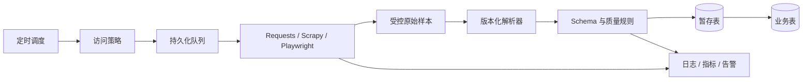

# 从入门到工程化：12 周路线

学习目标不是抓取“最难的网站”，而是构建一个授权明确、数据可信、负载可控、能够长期运行的采集系统。

## 12 周学习计划

| 周次 | 主题                             | 实践交付物                          |
| ---- | -------------------------------- | ----------------------------------- |
| 1    | Python、虚拟环境、类型与异常     | 可测试的文本清洗函数                |
| 2    | URL、HTTP、状态码、编码          | 带超时和错误分类的下载器            |
| 3    | HTML、CSS 选择器、Beautiful Soup | 静态列表与详情页解析器              |
| 4    | XPath、JSON-LD、Schema           | 带类型与来源字段的数据模型          |
| 5    | API、分页、会话和增量            | Cursor / 水位可恢复同步器           |
| 6    | Playwright 动态页面              | 使用业务条件等待的授权采集器        |
| 7    | 线程、asyncio、aiohttp           | 有并发、速率和总量上限的请求器      |
| 8    | Scrapy 架构与 Pipeline           | 支持分页、去重和 Feed Export 的项目 |
| 9    | SQLite / PostgreSQL、幂等与批次  | 可重跑的增量数据管道                |
| 10   | fixture、契约和漂移测试          | 离线回归集与质量门槛                |
| 11   | robots、隐私、SSRF 与供应链      | 威胁模型和合规检查表                |
| 12   | 部署、监控、恢复和复盘           | 可演示的端到端项目与运行手册        |

## 综合项目：授权目录同步系统

数据源可以选择：

- 你自己搭建的本地测试站。
- 数据所有者书面授权的目录站点。
- [Scrapy 官方教程](https://docs.scrapy.org/en/latest/intro/tutorial.html)使用的 `quotes.toscrape.com` 等练习站点。
- 明确允许自动访问的开放 API。

不要把真实商业网站当作无授权练习环境。

### 目标架构

### 必做功能

1. 允许域名、路径、robots、速率、并发、页数和运行时长策略。
2. 列表页、详情页或 API 分页，URL 规范化和去重。
3. 明确 Schema、必填字段、来源、获取时间和解析器版本。
4. SQLite 或 PostgreSQL 幂等 Upsert。
5. 任务水位、暂停恢复和失败死信。
6. 保存的 fixture 与解析器回归测试。
7. 请求、解析、数据质量和批次四层指标。
8. 漂移时暂停发布，修复后小批量灰度与补跑。
9. README、架构图、授权说明、运行手册和删除流程。

### 加分功能

- ETag / Last-Modified 条件请求。
- 原始响应内容寻址存储和保留期清理。
- JSON Schema 或数据模型自动校验。
- OpenTelemetry Trace 或结构化 JSON 日志。
- 容器化、非 root 运行和只读文件系统。
- 质量报告、批次对比和页面模板漂移检测。

## 分阶段实现

### 阶段一：单页基线

只请求一个页面，保存 fixture，解析 3 ～ 5 个字段并写 JSONL。确认字段含义和授权，不做并发。

### 阶段二：分页与详情

加入 URL 规范化、允许范围、去重、分页终止条件和请求上限。记录每页记录数。

### 阶段三：数据管道

引入 Schema、清洗、SQLite、唯一键、内容哈希和批次事务，使任务重复运行不产生重复数据。

### 阶段四：可靠性

加入超时、受控重试、速率、持久化队列、水位、死信、优雅停止和失败恢复。

### 阶段五：运营能力

建立看板、质量门槛、漂移告警、运行手册、灰度发布、补跑和数据删除流程。

## 能力检查表

### 入门

- 能解释 URL、请求、响应、Cookie、DOM 和分页。
- 能用 Requests 获取授权页面，并处理超时和状态码。
- 能用 CSS 或 XPath 提取字段并输出 JSONL。

### 熟练

- 能选择 HTML、API 或浏览器方案，不滥用 Playwright。
- 能处理会话、编码、相对 URL、增量更新和幂等写入。
- 能用 fixture 测试解析器，并发现字段缺失和模板变化。

### 进阶

- 能设计并发、速率、背压、URL Frontier 和恢复机制。
- 能扩展 Scrapy 的 Spider、Middleware、Pipeline 和统计。
- 能做容量估算、漂移监控、批次发布和故障补偿。

### 工程化

- 能把访问授权、数据权利、安全和删除机制落实到代码与流程。
- 能证明系统不会访问允许范围之外的地址或无限扩张。
- 能解释每条记录的来源、获取时间、解析版本和质量状态。
- 能在站方要求、异常负载或质量事故时快速停止并安全恢复。

## 面试与复盘题

1. 为什么请求必须设置连接和读取超时？
2. Session、Cookie 和连接池分别解决什么问题？
3. CSS 与 XPath 如何选择？怎样让选择器更耐变化？
4. 为什么 Semaphore 不等于每秒请求数限制？
5. 429、403、5xx 和解析失败的重试策略有什么不同？
6. 如何避免分页时重复、遗漏或陷入循环？
7. Scrapy 的 Engine、Scheduler、Downloader、Spider 和 Pipeline 如何流转？
8. 动态页面什么时候使用 Playwright，什么时候应寻找官方 API？
9. 如何判断数据已删除，而不是本次请求失败？
10. 页面仍返回 200，但数据全为空，系统如何发现？
11. 爬虫为什么容易产生 SSRF？如何设计网络边界？
12. `robots.txt`、访问授权和数据使用许可有什么区别？

## 项目验收标准

| 维度     | 验收要求                                     |
| -------- | -------------------------------------------- |
| 合规     | 来源、用途、授权、robots 和保留期有记录      |
| 范围     | 域名、路径、页数、速率、并发和总时间有硬限制 |
| 正确性   | Schema 明确，fixture 回归和质量规则通过      |
| 可恢复   | 支持幂等重跑、水位、死信和批次补偿           |
| 可观测   | 能看到请求、解析、数据与任务指标             |
| 安全     | 凭证、SSRF、不可信响应和依赖风险有控制       |
| 可维护   | 获取、解析、清洗、存储分层，版本可以回滚     |
| 影响可控 | 429、授权或 robots 变化会自动暂停或降速      |

当你的系统不仅“今天能抓到”，还能说明为什么允许抓、如何保证正确、发生变化如何止损，并在数月后安全复现时，才算真正完成了从脚本到工程的进阶。
