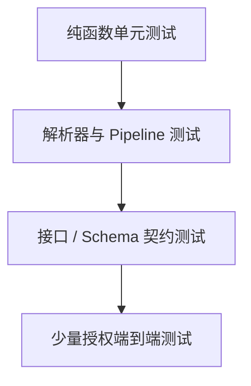

# 测试、监控与可靠性

爬虫最大的长期风险不是代码崩溃，而是“仍在运行，却悄悄产出错误数据”。可靠性必须同时覆盖网络、解析、数据和调度。

## 测试金字塔



大部分测试应对保存的 fixture 离线运行。真实网络测试数量少、频率低，并严格限速。

## 解析器单元测试

```python
from pathlib import Path

from crawler.parse import parse_page


def test_parse_quotes_fixture() -> None:
    html = Path("tests/fixtures/quotes-page-1.html").read_text(encoding="utf-8")

    rows, next_url = parse_page(
        html,
        "https://quotes.toscrape.com/page/1/",
    )

    assert len(rows) == 10
    assert all(row["text"] for row in rows)
    assert all(row["author"] for row in rows)
    assert next_url == "https://quotes.toscrape.com/page/2/"
```

再补充边界 fixture：

- 正常页面。
- 空列表、最后一页。
- 可选字段缺失。
- 必填字段缺失。
- 异常空白、Unicode 和实体字符。
- 页面模板小幅变化。
- 返回登录页、错误页或非预期 Content-Type。

Fixture 只保留获得授权的最小内容，必要时脱敏；不要把真实用户数据提交到 Git。

## 解析函数的设计

易测试的解析器应满足：

```python
def parse_page(body: str, source_url: str) -> ParseResult:
    ...
```

- 输入显式，不读取网络、当前时间或全局变量。
- 输出包含记录、下一页和结构化警告。
- 相同输入得到相同结果。
- 必填字段错误不会被静默吞掉。

当前时间、解析器版本等运行元数据，由外层 Pipeline 注入。

## 契约测试

契约测试验证数据源仍满足最低假设，例如：

- 状态码和 Content-Type 正确。
- 页面存在稳定容器或 API 返回预期根字段。
- 列表记录数在合理范围。
- API 分页游标没有循环。
- robots 或使用条款没有发生需要复审的变化。

契约测试失败时先暂停下游发布并通知维护者，不要立即自动修改选择器继续运行。

## 不要只做大快照

整页 HTML 快照很容易因广告、时间戳和资源哈希产生噪声。更好的断言是：

- 关键容器存在且唯一。
- 提取的业务字段满足 Schema。
- 规范化后的少量代表记录与期望一致。
- 字段缺失率、枚举和长度分布没有突变。

原始响应仍可用于故障调查，但不应成为唯一测试依据。

## 可观测性四层

| 层级 | 关键指标                                     |
| ---- | -------------------------------------------- |
| 请求 | 状态码、延迟、字节数、重试、重定向、429 比例 |
| 解析 | 页面数、记录数、字段缺失、解析异常、模板版本 |
| 数据 | 新增、更新、重复、删除候选、质量规则失败     |
| 任务 | 队列深度、水位、成功批次、运行时长、资源用量 |

日志用于解释单次事件，指标用于发现趋势，Trace 用于串联“调度 → 下载 → 解析 → 存储”。三者使用同一个 `run_id`、`request_id` 和 `batch_id`。

## 结构化日志

```python
import logging

logger = logging.getLogger(__name__)

logger.info(
    "page_parsed",
    extra={
        "run_id": run_id,
        "host": "quotes.toscrape.com",
        "status_code": 200,
        "duration_ms": 182,
        "item_count": 10,
        "parser_version": "git:abc123",
    },
)
```

生产环境可使用 JSON 日志格式。URL 中的查询参数、Cookie、Token、响应正文和个人数据默认不记录。

## 页面漂移检测

漂移信号包括：

- 成功请求数不变，但记录数突然变为零。
- 必填字段非空率明显下降。
- 页面体积、DOM 特征或 API Schema 改变。
- 新枚举值大量出现。
- 同一页重复内容增加。
- 列表页与详情页的数量关系异常。

采用绝对阈值与相对基线结合。例如“价格非空率低于 98%”和“较过去七天均值下降 10 个百分点”均可触发暂停发布。

## SLO 与告警

示例目标：

```text
每天 08:00 前完成一次同步
授权范围内页面成功率 ≥ 99%
必填字段有效率 ≥ 99.5%
从来源更新到业务可用的 P95 延迟 ≤ 6 小时
429 连续出现或 robots 改变时立即暂停
```

告警必须对应动作：谁处理、先检查什么、何时暂停、如何补跑。没有运行手册的告警只会制造噪声。

## 调度与重叠运行

无论使用系统定时器、CI、工作流平台还是容器任务，都要处理：

- 防止同一任务重叠运行，可用租约或分布式锁。
- 固定代码、依赖、配置和解析器版本。
- 设置总时长、最大请求数、最大费用和终止信号。
- 优雅停止：不再领新任务，提交当前事务，保存队列和水位。
- 区分任务执行成功与数据质量验收成功。

## 故障恢复


修复后不要默认全量重跑。先确定受影响时间窗、记录范围和删除风险，再以幂等方式补偿。

## 发布清单

- 所有解析测试、Schema 校验和授权检查通过。
- 新版本在保存的历史 fixture 上没有意外回归。
- 目标域名、路径、速率和总量有硬限制。
- 支持灰度、暂停、恢复和回滚解析器版本。
- 看板能发现“成功但无数据”和字段级退化。
- 故障样本、日志和原始响应都有访问控制与保留期。
