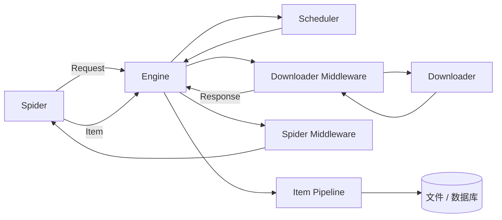

# Scrapy 工程化

Scrapy 适合递归抓取、多页面类型、可恢复任务和长期维护项目。它把网络、调度、解析、数据处理和扩展点拆分开，避免一个脚本同时承担所有职责。

## 核心架构



官方[架构文档](https://docs.scrapy.org/en/latest/topics/architecture.html)说明：Engine 控制数据流，Scheduler 管理请求队列，Downloader 获取响应，Spider 解析并产生 Item 或新请求，Item Pipeline 负责清洗、校验和持久化。

## 创建项目

```bash
python -m pip install scrapy
scrapy startproject catalog_crawler
cd catalog_crawler
scrapy genspider quotes quotes.toscrape.com
```

典型结构：

```text
catalog_crawler/
├── scrapy.cfg
└── catalog_crawler/
    ├── items.py
    ├── middlewares.py
    ├── pipelines.py
    ├── settings.py
    └── spiders/
        └── quotes.py
```

## Spider

```python
import scrapy


class QuotesSpider(scrapy.Spider):
    name = "quotes"
    allowed_domains = ["quotes.toscrape.com"]
    start_urls = ["https://quotes.toscrape.com/"]

    custom_settings = {
        "ROBOTSTXT_OBEY": True,
        "CONCURRENT_REQUESTS_PER_DOMAIN": 2,
        "DOWNLOAD_DELAY": 1.0,
    }

    def parse(self, response: scrapy.http.Response):
        for quote in response.css("div.quote"):
            yield {
                "text": quote.css("span.text::text").get(),
                "author": quote.css("small.author::text").get(),
                "tags": quote.css("a.tag::text").getall(),
                "source_url": response.url,
            }

        next_href = response.css("li.next a::attr(href)").get()
        if next_href:
            yield response.follow(next_href, callback=self.parse)
```

`allowed_domains` 是抓取边界之一，但不能替代授权和 URL 安全检查。练习站点和示例来自 [Scrapy 官方教程](https://docs.scrapy.org/en/latest/intro/tutorial.html)。

## Item 与类型

对于稳定项目，明确数据模型而不是随意字典：

```python
import scrapy


class QuoteItem(scrapy.Item):
    text = scrapy.Field()
    author = scrapy.Field()
    tags = scrapy.Field()
    source_url = scrapy.Field()
    fetched_at = scrapy.Field()
```

Item 描述字段，业务校验放在 Pipeline 或独立模型层。不要让 Spider 同时清洗、写数据库和发送业务消息。

## Item Pipeline

```python
from itemadapter import ItemAdapter
from scrapy.exceptions import DropItem


class ValidateQuotePipeline:
    def process_item(self, item, spider):
        adapter = ItemAdapter(item)
        text = (adapter.get("text") or "").strip()
        author = (adapter.get("author") or "").strip()

        if not text or not author:
            raise DropItem("缺少正文或作者")

        adapter["text"] = text
        adapter["author"] = author
        adapter["tags"] = sorted(set(adapter.get("tags") or []))
        return item
```

设置 Pipeline 顺序：

```python
ITEM_PIPELINES = {
    "catalog_crawler.pipelines.ValidateQuotePipeline": 100,
    "catalog_crawler.pipelines.DeduplicatePipeline": 200,
    "catalog_crawler.pipelines.StoragePipeline": 300,
}
```

数字越小越先执行。推荐顺序是规范化 → 校验 → 去重 → 存储。

## Middleware 用在什么地方

- **Downloader Middleware**：统一请求头、域名级策略、响应审计、受控重试。
- **Spider Middleware**：对 Spider 输入输出做统一处理。
- **Pipeline**：只处理提取后的 Item。
- **Extension**：统计、内存限制、任务生命周期和自定义监控。

站点解析逻辑留在 Spider；跨站通用的网络策略放 Middleware；不要把所有逻辑都塞进一个中间件。

## 保守设置

```python
ROBOTSTXT_OBEY = True
CONCURRENT_REQUESTS = 8
CONCURRENT_REQUESTS_PER_DOMAIN = 2
DOWNLOAD_DELAY = 1.0
RANDOMIZE_DOWNLOAD_DELAY = True

AUTOTHROTTLE_ENABLED = True
AUTOTHROTTLE_START_DELAY = 1.0
AUTOTHROTTLE_MAX_DELAY = 30.0
AUTOTHROTTLE_TARGET_CONCURRENCY = 1.0

RETRY_ENABLED = True
RETRY_TIMES = 2
DOWNLOAD_TIMEOUT = 30

FEEDS = {
    "var/quotes-%(time)s.jsonl": {
        "format": "jsonlines",
        "encoding": "utf-8",
        "overwrite": False,
    }
}
```

AutoThrottle 用于平滑负载，不是寻找站点承载极限。站方给出的明确速率始终优先。

## 去重、深度和爬取范围

Scrapy 默认对请求指纹去重，但项目仍需限制：

- 允许域名、端口、路径前缀和查询参数。
- 最大页面数、最大深度、总运行时间和下载体积。
- 日历、站内搜索、筛选组合等无限 URL 空间。
- 登出、删除、购买等有副作用的链接。

可以通过 `CLOSESPIDER_PAGECOUNT`、`CLOSESPIDER_TIMEOUT`、`DEPTH_LIMIT` 等设置建立硬上限。

## 暂停与恢复

```bash
scrapy crawl quotes -s JOBDIR=var/jobs/quotes-2026-10-06
```

`JOBDIR` 可持久化调度状态，便于暂停恢复。每次任务使用独立目录；不要同时让多个进程共享同一目录。恢复前确认代码、策略和认证状态是否仍兼容。

## 导出与运行

```bash
scrapy crawl quotes
scrapy crawl quotes -O var/quotes.jsonl
scrapy shell "https://quotes.toscrape.com/"
```

Feed Export 足以覆盖简单文件输出；需要事务、幂等更新或跨表关系时，再编写数据库 Pipeline。

## 何时不需要 Scrapy

- 只调用少量官方 JSON API。
- 一次性处理几十个页面。
- 主要工作是浏览器交互，而非链接递归。
- 团队只需要一个可以离线运行的解析工具。

框架的价值来自调度和长期治理，不是让短脚本显得更“高级”。
